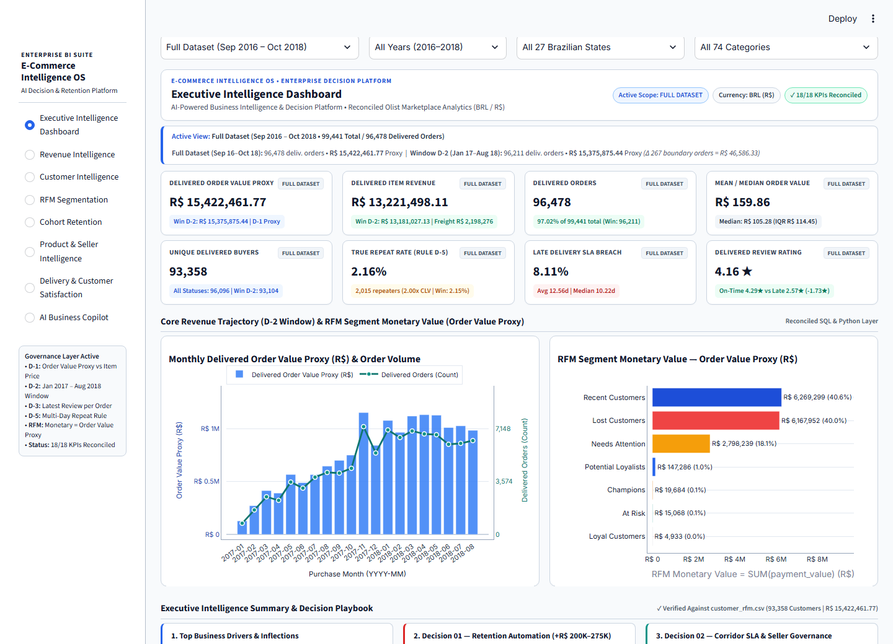
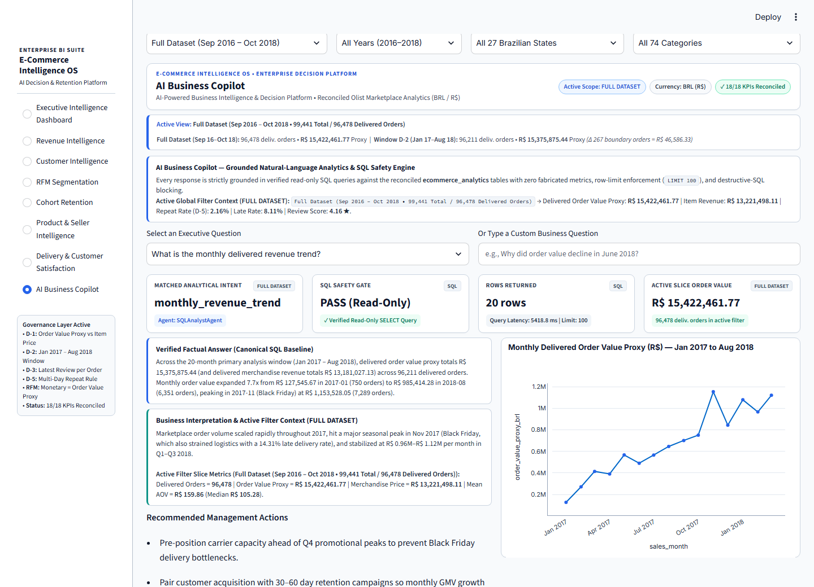
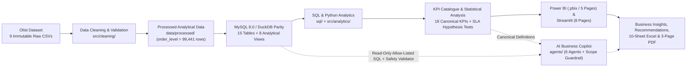
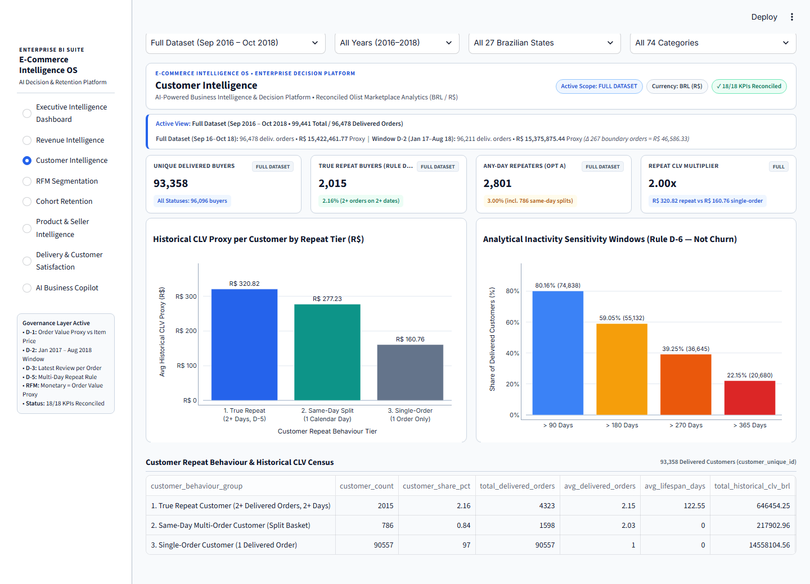
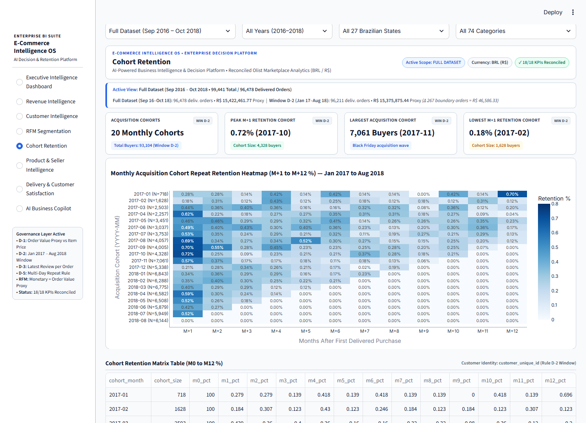
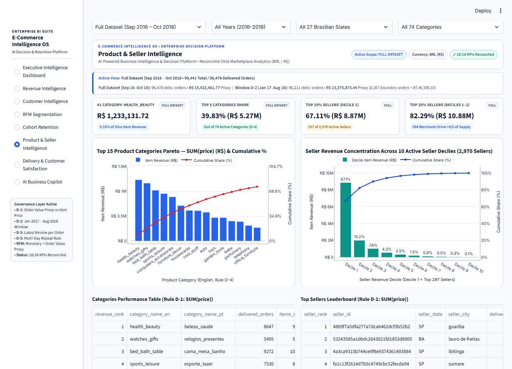
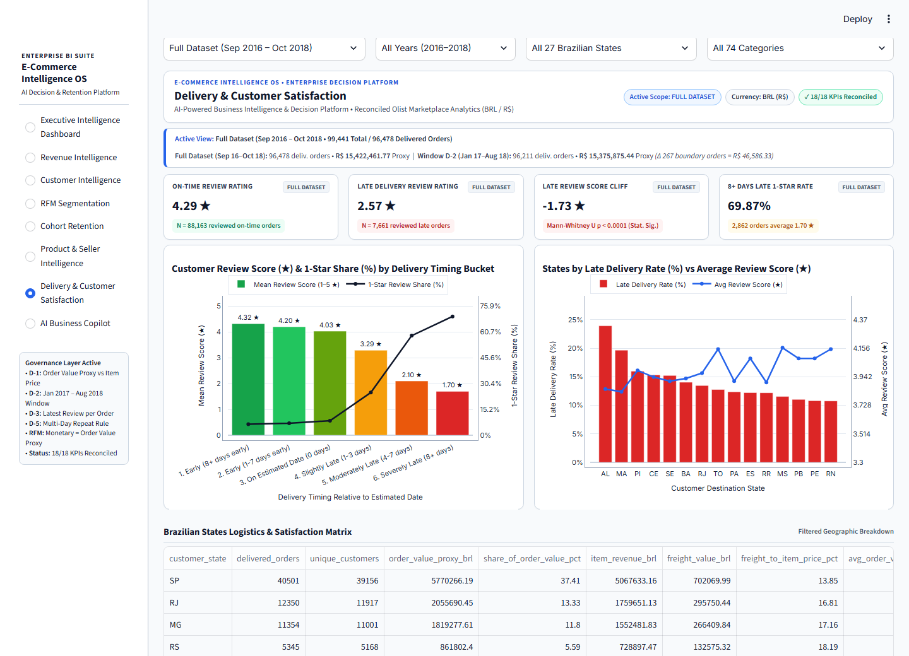

# CommerceLens AI
### AI-Powered E-Commerce Intelligence Platform

> **Turning E-Commerce Data into Intelligent Business Decisions.**

[](requirements.txt)
[](sql/)
[](powerbi/Ecommerce_Intelligence_OS.pbix)
[](app/streamlit_app.py)
[](tests/test_analytics_pipeline.py)

**CommerceLens AI** is an end-to-end Data Analytics and Business Intelligence portfolio platform built on the public **Olist Brazilian E-Commerce Dataset** (`1,550,922` raw records, `9` source CSVs, `99,441` orders from Sept 2016 to Oct 2018). It combines a grain-safe Python cleaning pipeline, a `15`-table MySQL 8.0 / DuckDB relational warehouse, an `18`-KPI centralized governance layer, a compiled `5`-page **Power BI Desktop `.pbix`** workbook (`34.89 MB`), an `8`-page **Streamlit** web application, a `10`-sheet Excel workbook, a `3`-page PDF report, and a read-only **AI Business Copilot**.

| Executive Intelligence View (Streamlit) | AI Business Copilot (Streamlit) |
|---|---|
|  |  |

---

## Table of Contents

- [A. Business Problem & Objectives](#a-business-problem--objectives)
- [B. Technology Stack](#b-technology-stack)
- [C. System Architecture & End-to-End Workflow](#c-system-architecture--end-to-end-workflow)
- [D. Repository Structure](#d-repository-structure)
- [E. Dashboard Showcase (Power BI & Streamlit)](#e-dashboard-showcase-power-bi--streamlit)
- [F. Verified Business Insights & Analytical Findings](#f-verified-business-insights--analytical-findings)
- [G. KPI Definitions & Metric Governance (D-1 to D-6)](#g-kpi-definitions--metric-governance-d-1-to-d-6)
- [H. AI Business Copilot & SQL Safety Architecture](#h-ai-business-copilot--sql-safety-architecture)
- [I. Project Setup & Execution (Windows)](#i-project-setup--execution-windows)
- [J. Verification, Testing & Audit Results](#j-verification-testing--audit-results)
- [K. Project Limitations, Future Scope & Attribution](#k-project-limitations-future-scope--attribution)

---

## A. Business Problem & Objectives

### Business Questions Answered

| # | Executive Question | Primary Component / View Answering It |
|---|---|---|
| 1 | Which products and categories generate the highest merchandise revenue? | `sql/02_business_analysis/02_product_and_category_performance.sql`, Power BI Page 2 & 4, Streamlit Page 6 |
| 2 | How is order value changing over time? | `vw_executive_monthly_kpis`, Power BI Page 1 & 2, Streamlit Page 1 & 2 |
| 3 | Which customers make repeat purchases under strict multi-day rules? | `sql/03_customer_analytics/01_repeat_customer_analysis.sql`, Power BI Page 3 & 5, Streamlit Page 3 |
| 4 | Which customer segments need retention attention? | `customer_rfm` & `vw_rfm_segments_summary`, Power BI Page 3, Streamlit Page 4 |
| 5 | How does delivery performance relate to customer review scores? | `sql/02_business_analysis/04_delivery_and_satisfaction_analysis.sql`, Power BI Page 4, Streamlit Page 7 |
| 6 | Which sellers account for the largest share of merchandise revenue? | `sql/02_business_analysis/03_seller_performance_analysis.sql` (`NTILE(10)` deciles), Power BI Page 4, Streamlit Page 6 |
| 7 | Which payment methods contribute the most transaction value? | `sql/02_business_analysis/05_payment_and_installment_analysis.sql`, `payments_clean`, Power BI Page 2, Streamlit Page 2 |
| 8 | Where are analytical opportunities to improve CX and retention? | `reports/executive_summary/Ecommerce_Intelligence_OS_Executive_Report.pdf`, Copilot Intent 8 |

### Business Objectives
- Improve revenue visibility across order, merchandise item, freight, and payment grains without join fan-out.
- Measure true repeat purchasing (`customer_unique_id`) separately from same-day checkout splits.
- Quantify category/seller Pareto concentration and delivery-delay SLA bottlenecks to inform prioritized analytical recommendations (all savings and uplift figures represent analytical estimates, not realized corporate deployment gains).

---

## B. Technology Stack

- **Data Engineering & Analytics:** Python, Pandas, NumPy, SciPy (`Mann-Whitney U`, `Welch's t`), Matplotlib, Seaborn, Jupyter Notebooks
- **Databases & SQL:** SQL, MySQL 8.0 (`SQLAlchemy` + `PyMySQL`), DuckDB (automatic local parity engine)
- **Business Intelligence:** Power BI Desktop (`.pbix` + `.pbip`, TMDL, DAX, Power Query M), Streamlit, Plotly
- **Executive Reporting & QA:** Excel (`OpenPyXL` 10-sheet workbook with formulas), PDF (`Matplotlib PdfPages`), `Pytest`, Git & GitHub CLI

---

## C. System Architecture & End-to-End Workflow

### Architecture Diagram



### End-to-End 11-Step Workflow

1. **Dataset Collection & Inspection** (`src/ingestion/check_files.py`, `validate_raw_data.py`): SHA-256 verification and schema checks across all `9` raw Olist CSVs (`1,550,922` rows).
2. **Data Quality Assessment** (`src/cleaning/quality_assessment.py`, `docs/data_quality_log.md`): Audited PK/FK integrity, missing categories (`610` products), delivery nulls vs order statuses, and review duplicates.
3. **Cleaning & Transformation** (`src/cleaning/build_clean_datasets.py`): Pre-aggregated `order_items` (`112,650`), `payments` (`103,886`), and `reviews` (`99,224`) to `1:1` `order_id` before joining `orders_clean` into `order_level` (`99,441` rows), retaining quality flags instead of silent deletions, and filtering Brazilian coordinates into `geolocation_zip_lookup` (`17,737` zip prefixes).
4. **Database Loading & Validation** (`src/database/load_data_to_mysql.py`, `verify_live_mysql.py`): Populated local MySQL 8.0 (`ecommerce_analytics`) and verified `15/15` tables with `0` row differences against cleaned CSVs.
5. **SQL Business Analysis** (`sql/01..05/`): Authored `14` analytical scripts and `8` reusable views (`sql/05_views/01_analytical_views.sql`).
6. **Python Analytics & Statistical Testing** (`src/analytics/kpi_engine.py`, `chart_generator.py`, `notebooks/`): Computed cohort retention, RFM segmentation, seller deciles, and SLA satisfaction hypothesis tests.
7. **KPI Reconciliation & Metric Governance** (`src/analytics/metric_catalogue.py`, `reconciliation_engine.py`): Enforced `18` canonical KPIs and verified `18/18` cross-platform numerical parity.
8. **Power BI Dashboard Development** (`powerbi/Ecommerce_Intelligence_OS.pbix`, `.pbip`, `scripts/build_powerbi_project.ps1`): Built `19`-table semantic model (`10` single-direction relationships, `39` weighted DAX measures) with synced dropdown slicers.
9. **Streamlit Interactive Application** (`app/streamlit_app.py`): Delivered `8` interactive modules connected to the same verified outputs with global filters.
10. **AI Business Copilot** (`agents/orchestrator.py`, `agents/tools/sql_safety_validator.py`): Integrated `6` specialized agents with strict read-only SQL allow-list checks and out-of-scope refusals.
11. **Testing & Executive Reporting** (`tests/test_analytics_pipeline.py`, `src/reporting/excel_report_builder.py`, `pdf_report_builder.py`): Validated all layers via `18` automated tests and exported `10`-sheet Excel and `3`-page PDF executive reports.

---

## D. Repository Structure

| Directory | Purpose | Key Contents |
|---|---|---|
| `app/` | Streamlit web dashboard | `streamlit_app.py` (8-page BI application) |
| `agents/` | Multi-agent Copilot & safety gate | `orchestrator.py`, `sql_analyst_agent.py`, `sql_safety_validator.py` |
| `config/` | Settings & parameters | `settings.py` (environment-variable DB configuration, zero hardcoded secrets) |
| `data/` | Data layout & manual mappings | `raw/` (excluded), `processed/` (gitignored CSVs), `external/category_translation_supplement.csv` |
| `docs/` | Technical & audit docs | `architecture.md`, `limitations.md`, `mysql_live_verification_report.md`, `screenshots/` |
| `notebooks/` | Exploratory & analytical notebooks | `01..06_*.ipynb` |
| `powerbi/` | Power BI BI suite | `Ecommerce_Intelligence_OS.pbix` (`34.89 MB`), `.pbip`, `dax/`, `data_exports/`, `scripts/`, `theme/` |
| `reports/` | Generated reports & evidence | `analytics_summary.json`, `charts/*.png`, `executive_summary/*.xlsx/.pdf`, `reconciliation/` |
| `sql/` | Warehouse schema, queries & views | `01_create_database.sql`, `01..04_*/*.sql`, `05_views/01_analytical_views.sql` |
| `src/` | Python engineering pipeline | `cleaning/`, `database/`, `analytics/`, `reporting/`, `ingestion/` |
| `tests/` | Automated QA suite | `test_analytics_pipeline.py` (`18/18` passing) |

---

## E. Dashboard Showcase (Power BI & Streamlit)

### Five Power BI Report Pages ([`powerbi/Ecommerce_Intelligence_OS.pbix`](powerbi/Ecommerce_Intelligence_OS.pbix))
1. **Executive Overview:** Top-line delivered orders, checkout value proxy, merchandise revenue, D-5 repeat rate (`2.16%`), review score, monthly order trend, top categories, and RFM customer breakdown.
2. **Revenue Intelligence:** Checkout value vs merchandise `SUM(price)` vs freight separation, monthly revenue vs freight, payment method donut (`payments_clean`), category leaderboard, and order lifecycle statuses.
3. **Customer Intelligence:** Unique delivered customers (`93,358`), D-5 true repeat (`2,015`) vs same-day multi-order (`786`), weighted RFM monetary summary, and repeat-vs-single CLV economics.
4. **Product and Seller Performance:** Active delivered sellers (`2,970`), delivery timing bucket review cliff, state SLA scorecard, and seller-grain merchandise revenue leaderboard.
5. **Retention Analysis:** Weighted monthly cohort retention matrix (`Cohort Retention Rate %`: `100.00%` at M0, `0.18%–0.72%` at M1), cohort acquisition sizes, and repeat CLV share.

*Slicer Design:* Synced dropdown slicers (`Year`, `Analysis Window`, `Customer State`, `Product Category`, plus `Payment Method` on Page 2) operate under single-direction star-schema filtering so `Product Category` filters item/category/seller visuals without inflating `order_level` checkout totals. Download and open `powerbi/Ecommerce_Intelligence_OS.pbix` (`34.89 MB`) directly in Power BI Desktop to explore live interactivity.

### Eight Streamlit Application Pages ([`app/streamlit_app.py`](app/streamlit_app.py))
1. **Executive Intelligence Dashboard** — `Full Dataset` vs `Window D-2` toggle, KPI cards, monthly combo trend, RFM & top category bars.
2. **Revenue Intelligence** — Monthly range slider, payment method filter, revenue decomposition, MoM growth, and credit-card installments.
3. **Customer Intelligence** — D-5 (`2.16%`) vs same-day split checkouts (`0.84%`), historical CLV proxy comparison, and D-6 inactivity bands.
4. **RFM Segmentation** — `7` segments across `93,358` customers and CRM prioritization table.
5. **Cohort Retention** — `20 × 12` retention heatmap (`2017-01` to `2018-08`) and cohort M+1 trajectory.
6. **Product & Seller Intelligence** — `74` categories Pareto curve and `10`-decile seller revenue concentration.
7. **Delivery & Customer Satisfaction** — Welch's $t$ / Mann-Whitney $U$ scorecard, delay bucket cliff, and Brazilian state SLA map/scatter.
8. **AI Business Copilot** — Natural-language presets, read-only SQL sandbox, grounded answers, SQL inspector, and audit log.

| Revenue Intelligence | Customer Intelligence | RFM Segmentation | Cohort Retention |
|---|---|---|---|
|  |  |  |  |

| Product & Seller Intelligence | Delivery & Satisfaction | Monthly Revenue Chart | Delivery Delay vs Review Cliff |
|---|---|---|---|
|  |  |  |  |

---

## F. Verified Business Insights & Analytical Findings

| Metric / Finding | Full Dataset (Sep 2016–Oct 2018) | Main Window D-2 (Jan 2017–Aug 2018) | Grain & Basis |
|---|---:|---:|---|
| **Total Orders / Delivered Orders** | `99,441` / **`96,478`** (`97.02%`) | `99,092` / **`96,211`** | Order-level (`order_level`) |
| **Delivered Order Value Proxy** | **`R$ 15,422,461.77`** | **`R$ 15,375,875.44`** | Order-level `SUM(payment_value)` (Rule D-1) |
| **Delivered Merchandise Revenue** | **`R$ 13,221,498.11`** | **`R$ 13,181,027.13`** | Item-level `SUM(price)` (Rule D-1) |
| **Delivered Freight Value** | **`R$ 2,198,275.64`** | `R$ 2,192,092.88` | Item-level `SUM(freight_value)` (Rule D-1) |
| **Mean / Median Order Value Proxy** | **`R$ 159.86`** / **`R$ 105.28`** | `R$ 159.81` / `R$ 105.28` | Order-level (`IQR R$ 114.45`) |
| **Unique Delivered Customers** | **`93,358`** | **`93,104`** | `customer_unique_id` |
| **True Repeat Customers (D-5)** | **`2,015` (`2.16%`)** | **`2,005` (`2.15%`)** | $\ge 2$ delivered orders on $\ge 2$ distinct dates |
| **Same-Day Split / Option-A Repeat** | **`786` (`0.84%`)** / `2,801` (`3.00%`) | `—` | Split-checkout orders separated from D-5 |
| **Historical CLV Proxy (D-5 vs Single)** | **`R$ 320.82` vs `R$ 160.76`** | `—` | `2.0x` lifetime spend ratio (`4.19%` total value share) |
| **Top Product Categories** | `health_beauty`: **`R$ 1,233,131.72`** | `—` | Top 5 categories = `39.83%` of item revenue (`74` categories) |
| **Seller Pareto Concentration** | Top `10%` (`297`/`2,970`) = **`67.11%`** | `—` | `R$ 8,873,076.37` item revenue; Top `20%` = `82.29%` |
| **Payment Mix (`payments_clean`)** | Credit Card: **`78.46%` (`R$ 12.10M`)** | `—` | Payment-level (`Boleto 17.96%`, `Voucher 2.23%`, `Debit 1.35%`) |
| **Late Delivery & Review Penalty** | **`8.11%`** late (`12.56` avg days) | `8.12%` late | On-time **`4.29★`** vs Late **`2.57★`** (`-1.72★`, $p < 0.0001$) |
| **Cohort M+1 Repeat Retention** | `—` | **`0.184%–0.716%`** (`M+1`) | Across `19` cohorts with M+1 observation (`2017-01`–`2018-07`) |

*Why Grain Separation Matters:* Payment totals (`SUM(payment_value) = R$ 15,422,461.77`) exceed merchandise + freight (`R$ 13,221,498.11 + R$ 2,198,275.64 = R$ 15,419,773.75`) by `R$ 2,688.02` because installment interest is included in `payment_value` and `1` delivered order lacks payment records. Keeping order, item, and payment grains separated prevents Cartesian multiplication during joins.

---

## G. KPI Definitions & Metric Governance (D-1 to D-6)

- **D-1 (Financial Separation):** `SUM(payment_value)` on delivered orders = **Delivered Order Value Proxy** (`payment_value` is **not** company commission revenue; seller COGS, commissions, and marketing CAC are unavailable, so actual corporate profit and margins cannot be calculated). `SUM(price)` = **Merchandise Revenue**; `SUM(freight_value)` = **Freight Value**.
- **D-2 (Analysis Window):** Monthly trends and cohorts cover complete months **Jan 2017 – Aug 2018**, explicitly separating sparse boundary months (Sept–Dec 2016, Sept–Oct 2018).
- **D-3 (Review Deduplication):** Duplicate review rows (`98,410` unique `review_id`s across `99,224` rows) collapse deterministically to the latest review timestamp per order.
- **D-4 (Category Translations):** Retains original Portuguese category names alongside `71` official + `2` manual English mappings + `Unknown` (`610` products).
- **D-5 (True Repeat Rule):** Uses `customer_unique_id` and requires $\ge 2$ delivered orders on $\ge 2$ distinct purchase dates (`2,015` / `2.16%`), keeping `786` same-day multi-order buyers separate.
- **D-6 (Observational Inactivity & SLA):** Recency bands (`90/180/270/365` days) measure non-contractual inactivity, not confirmed churn; delivery delay vs review correlation (`-1.72★`) shows strong statistical association, not causal proof.

---

## H. AI Business Copilot & SQL Safety Architecture

Located in `agents/`, **`AnalyticsOrchestrator`** coordinates `6` specialized agents (`DataProfilerAgent`, `DataQualityAgent`, `SQLAnalystAgent`, `CustomerAnalyticsAgent`, `BusinessInsightAgent`, `ReportAgent`):
- **Supported Questions:** Monthly revenue trends, June 2018 drop decomposition (`-10.34%` MoM driven `93%` by order volume), RFM retention risk, D-5 repeat purchase rate, top categories, seller Pareto concentration, delivery delay review impact, cohort decay, regional SLAs, and management recommendations.
- **Grounded SQL Execution:** Executes deterministic SQL templates against local **MySQL 8.0** (when configured) or **DuckDB** (`data/processed/`), returning SQL queries, row counts, filter scope, and source tables with every answer.
- **Safety Gate ([`agents/tools/sql_safety_validator.py`](agents/tools/sql_safety_validator.py)):** Allows only single-statement `SELECT`/`WITH` queries against `23` allow-listed tables/views, blocks `DROP`, `DELETE`, `UPDATE`, `INSERT`, `ALTER`, `CREATE`, `TRUNCATE`, and semicolons, and enforces row limits (`LIMIT 100`).
- **Unsupported Questions:** Prompts requesting unmeasured metrics (e.g., net profit margin, COGS, marketing CAC, weather, forecasting) are declined safely with clear boundary explanations rather than fabricated numbers.

---

## I. Project Setup & Execution (Windows)

**Prerequisites:** Windows 10/11, Python `3.10+`, Power BI Desktop (to open `.pbix`/`.pbip`), and optional local MySQL 8.0 (`ecommerce_analytics`).

```powershell
# 1. Clone and create virtual environment
git clone https://github.com/ANUSHKA13102003/ecommerce-revenue-retention-intelligence.git
cd ecommerce-revenue-retention-intelligence
python -m venv .venv
.venv\Scripts\activate

# 2. Install dependencies
pip install -r requirements.txt

# 3. Download raw Olist CSVs from Kaggle into data/raw/
#    https://www.kaggle.com/datasets/olistbr/brazilian-ecommerce

# 4. Configure MySQL credentials securely (optional — DuckDB runs automatically if skipped)
copy .env.example .env
# Edit .env locally and set MYSQL_PASSWORD=<your_mysql_password> (never commit .env)

# 5. Run cleaning, SQL validation, KPI reconciliation & reports
python src/cleaning/build_clean_datasets.py
python src/database/load_data_to_mysql.py
python src/database/verify_live_mysql.py
python src/database/execute_and_validate_sql.py
python src/analytics/kpi_engine.py
python src/analytics/reconciliation_engine.py

# 6. Launch Streamlit Dashboard
streamlit run app/streamlit_app.py

# 7. Run Automated Test Suite
pytest tests/ -v
```

- **Open Power BI Report:** Double-click [`powerbi/Ecommerce_Intelligence_OS.pbix`](powerbi/Ecommerce_Intelligence_OS.pbix) in Power BI Desktop (no external database server required; CSV tables are embedded inside the workbook, or refresh from `powerbi/Ecommerce_Intelligence_OS.pbip` after regenerating local CSVs).

---

## J. Verification, Testing & Audit Results

| Verification Check | Result Observed | Reference |
|---|---|---|
| **`pytest tests/ -v`** | **`18/18` passed (`0` failed, `0` skipped)** | [`tests/test_analytics_pipeline.py`](tests/test_analytics_pipeline.py) |
| **Cross-Platform KPI Reconciliation** | **`18/18` PASS (`100%` parity)** | [`reports/reconciliation/reconciliation_report.md`](reports/reconciliation/reconciliation_report.md) |
| **Live MySQL 8.0 Verification** | **`15/15` tables (`0` diff) & `22/22` KPIs (`0.0` diff)** | [`docs/mysql_live_verification_report.md`](docs/mysql_live_verification_report.md) |
| **Power BI `.pbix` + `.pbip` Validation** | **`34.89 MB` `.pbix` saved, SDK-validated & reopened (`19` tables, `10` rels, `39` DAX)** | [`powerbi/Ecommerce_Intelligence_OS.pbix`](powerbi/Ecommerce_Intelligence_OS.pbix) |
| **Streamlit 8-Page Health & Slice Check** | **All 8 modules verified; `/_stcore/health` `200 ok`** | [`app/streamlit_app.py`](app/streamlit_app.py) |
| **Excel & PDF Reports** | **`10`-sheet Excel (`44` formulas) & `3`-page PDF (`75.3 KB`)** | [`reports/executive_summary/`](reports/executive_summary/) |
| **AI Copilot Safety & Guardrails** | **`DROP TABLE` blocked; unsupported prompt handled cleanly** | [`agents/orchestrator.py`](agents/orchestrator.py) |

---

## K. Project Limitations, Future Scope & Attribution

- **Limitations:** Historical **Sept 2016 – Oct 2018** Olist transactions in `BRL` (`R$`) prior to PIX; lacks product cost/commission/CAC fields; late-2018 repeat rates are right-censored; observational delivery vs. review correlation is not causal; portfolio demonstration platform only (not multi-tenant production SaaS or predictive ML deployment). See [`docs/limitations.md`](docs/limitations.md).
- **Future Scope (Not Implemented):** Automated incremental ingestion, probabilistic BG/NBD + Gamma-Gamma predictive CLV modeling, A/B retention experimentation, and optional external LLM tool-calling integration.
- **Dataset Attribution & Dual Licensing:**
  - Dataset sourced from the **[Olist Brazilian E-Commerce Public Dataset (Kaggle)](https://www.kaggle.com/datasets/olistbr/brazilian-ecommerce)** under **Creative Commons Attribution-NonCommercial-ShareAlike 4.0 International (`CC BY-NC-SA 4.0`)**.
  - Raw source CSVs (`data/raw/`) remain excluded from Git via `.gitignore`. Processed derivative data artifacts (`powerbi/data_exports/*.csv`) and the embedded VertiPaq `DataModel` inside [`powerbi/Ecommerce_Intelligence_OS.pbix`](powerbi/Ecommerce_Intelligence_OS.pbix) are published strictly for non-commercial portfolio evaluation under **`CC BY-NC-SA 4.0`** attribution.
  - Project source code, SQL scripts, DAX, and documentation are licensed under **MIT**.
- **Repository & Author:** [`https://github.com/ANUSHKA13102003/ecommerce-revenue-retention-intelligence`](https://github.com/ANUSHKA13102003/ecommerce-revenue-retention-intelligence) (`ANUSHKA13102003`).
