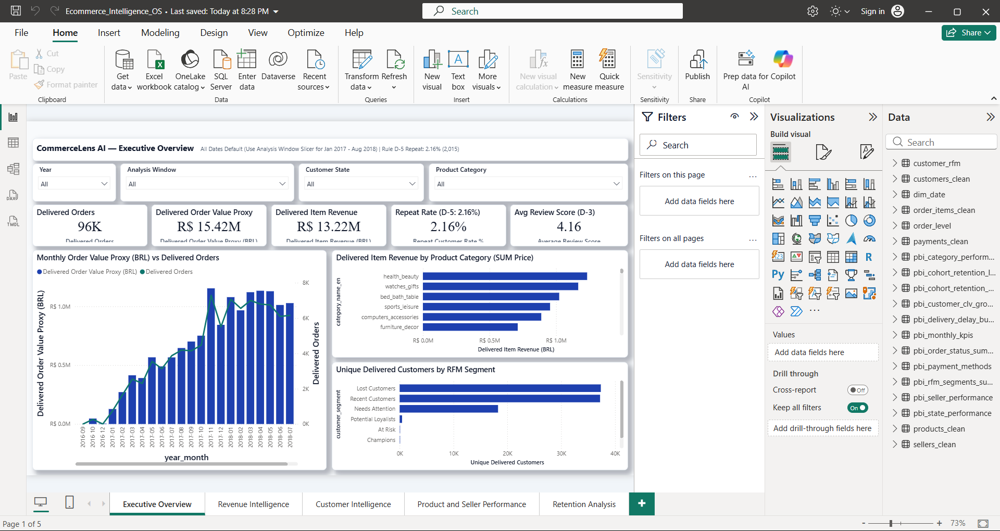

# E-Commerce Revenue & Retention Analysis

**Where does a Brazilian marketplace lose customers and revenue?** An analysis of 99,441 Olist orders (2016–2018) in SQL, Python and Power BI, ending in three actions the business can take.



[Power BI report](powerbi/Ecommerce_Intelligence_OS.pbix) · [Executive PDF](reports/executive_summary/Ecommerce_Revenue_Retention_Executive_Report.pdf) · [Methodology](docs/methodology.md)
<!-- TODO: add "Live app" link here once the Streamlit app is deployed -->

## What I found

| | Finding | Why it matters |
|---|---|---|
| 1 | **67%** of item revenue comes from the top 10% of sellers (297 of 2,970) | Supply depends on a small merchant core |
| 2 | Only **2.16%** of customers truly repeat (2,015 of 93,358); month-1 retention is under 1% | Growth is almost entirely new-buyer acquisition |
| 3 | Repeat buyers spend **2x** as much (R$320.82 vs R$160.76) | Small retention gains compound |
| 4 | Late orders average **2.57 stars** vs **4.29** on time (p < 0.0001) | Delivery SLAs protect ratings |

## What I'd do about it

1. **Retention:** run post-purchase campaigns for first-time buyers, starting with the 37,219 recent customers.
2. **Delivery:** escalate carriers in AL (23.9% late), MA (19.7%) and PI (16.0%). RJ is 13.5% late vs 5.9% in SP.
3. **Monitoring:** track delay rate next to review score so rising delays trigger action before ratings fall.

*Order value is a proxy, not company revenue or profit. The delivery-review link is association, not causation.*

## How it works

Raw Olist CSVs → Python cleaning → MySQL / DuckDB → 14 SQL scripts and 8 views → Power BI (5 pages), Streamlit app, tested KPIs

**Tools:** SQL, Python (pandas, SciPy), Power BI (DAX), Streamlit, pytest

**Three judgment calls that change the numbers** (details in [docs/methodology.md](docs/methodology.md)):
- *True repeat* means 2+ delivered orders on 2+ different days per `customer_unique_id`. Same-day split orders (786 buyers) are one shopping trip, not loyalty.
- Order items, payments and reviews are pre-aggregated to one row per order before joining, which avoids inflated revenue from join fan-out.
- Trends use Jan 2017 – Aug 2018 only, because 2016 and late 2018 are sparse or cut off.

## Run it

```bash
git clone https://github.com/ANUSHKA13102003/ecommerce-revenue-retention-intelligence.git
cd ecommerce-revenue-retention-intelligence
pip install -r requirements.txt
# download the 9 Olist CSVs from Kaggle into data/raw/
python src/cleaning/build_clean_datasets.py
python src/database/execute_and_validate_sql.py
streamlit run app/streamlit_app.py
pytest tests/
```

MySQL is optional. DuckDB runs automatically when no credentials are set.

## Repository

```
sql/         analysis scripts and views
src/         cleaning, database engine, KPI calculations
app/         Streamlit app
powerbi/     .pbix report and DAX measures
notebooks/   exploratory analysis
docs/        methodology, data dictionary, screenshots
reports/     executive PDF
tests/       pipeline tests
```

**Limitations:** no cost, margin or marketing data, so profit cannot be measured; data ends in 2018 and predates PIX payments.

Data: [Olist Brazilian E-Commerce](https://www.kaggle.com/datasets/olistbr/brazilian-ecommerce) (CC BY-NC-SA 4.0). Code: MIT.
