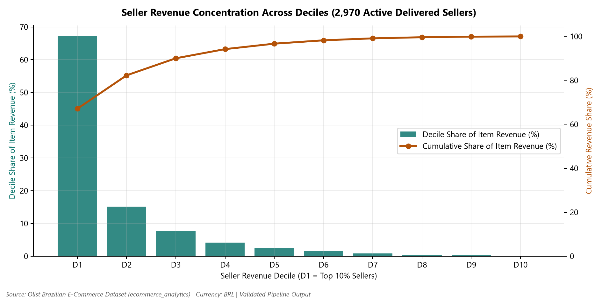

# 🛒 E-COMMERCE INTELLIGENCE OS — AI-Powered Business Intelligence & Decision Platform

> **Enterprise-Grade Business Analytics, SQL, Python, Power BI, Streamlit & Agentic AI Portfolio Product**  
> Built on the real-world **Olist Brazilian E-Commerce Public Dataset** (`9` raw CSV files, `1,550,922` raw records, `99,441` orders from Sept 2016 – Oct 2018). Every metric, SQL view, chart, statistical test, 10-sheet Excel workbook, 3-page PDF executive report, Power BI star-schema export, Streamlit module, and AI Business Copilot response is 100% reproducible, governed by an **18-KPI Centralised Metric Catalogue**, reconciled across all 5 layers, and verified by **18 automated `pytest` tests**.

---

## 📋 Table of Contents

- [Executive KPI Scorecard](#-executive-kpi-scorecard)
- [Business Problem & Governance Rules](#-business-problem--governance-rules)
- [System Architecture](#-system-architecture)
- [Visual Analytics & Chart Gallery](#-visual-analytics--chart-gallery)
- [Key Empirical Findings](#-key-empirical-findings)
  - [1. Revenue & Seasonality](#1-revenue--seasonality-jan-2017--aug-2018-analysis-window)
  - [2. Customer Retention & Cohort Decay](#2-customer-retention--cohort-decay)
  - [3. RFM Customer Segmentation](#3-rfm-customer-segmentation-93358-delivered-customers)
  - [4. Product Category & Seller Pareto Concentration](#4-product-category--seller-pareto-concentration)
  - [5. Delivery Performance vs. Customer Satisfaction](#5-delivery-performance-vs-customer-satisfaction-hypothesis-testing)
- [Strategic Business Recommendations](#-strategic-business-recommendations)
- [Enterprise Streamlit BI Dashboard (8 Modules)](#-enterprise-streamlit-bi-dashboard-8-modules)
- [AI Agentic Business Q&A Assistant](#-ai-agentic-business-qa-assistant)
- [Executive Excel Workbook & Power BI Star-Schema Package](#-executive-excel-workbook--power-bi-star-schema-package)
- [How to Install, Run & Connect](#-how-to-install-run--connect)
- [Automated Quality Assurance (`18/18` Passed)](#-automated-quality-assurance-1818-passed)
- [Limitations & Analytical Honesty](#-limitations--analytical-honesty)
- [Licence & Attribution](#-licence--attribution)

---

## 📊 Executive KPI Scorecard

All monetary figures are reported in **Brazilian Real (`BRL` / `R$`)**:

| Metric | Full Dataset (2016–2018) | Primary Analysis Window (Jan 2017 – Aug 2018) | Governance Rule / Source |
|---|---:|---:|---|
| **Total Orders (All Statuses)** | `99,441` | `99,092` | `orders_clean` |
| **Delivered Orders** | `96,478` (`97.02%` of all orders) | `96,211` | `order_level (is_delivered = 1)` |
| **Delivered Order Value Proxy (`SUM(payment_value)`)** | **`R$ 15,422,461.77`** | **`R$ 15,375,875.44`** | **Rule D-1:** Buyer total paid (`price + freight + installment interest`) |
| **Delivered Merchandise Revenue (`SUM(price)`)** | **`R$ 13,221,498.11`** | **`R$ 13,181,027.13`** | **Rule D-1:** Used for product, category & seller analysis |
| **Delivered Freight Value (`SUM(freight_value)`)** | **`R$ 2,198,275.64`** | `R$ 2,192,092.88` | **Rule D-1:** Reported separately from merchandise price |
| **Average Order Value (Mean / Median AOV)** | `R$ 159.86` / `R$ 105.28` | `R$ 159.81` / `R$ 105.28` | `IQR: R$ 114.45 (P25 R$ 61.85 – P75 R$ 176.30)` |
| **Unique Customers (`customer_unique_id`)** | `96,096` (all) / **`93,358`** (delivered) | `93,104` (delivered) | True customer identity (`customer_unique_id`) |
| **True Repeat Customers (Rule D-5)** | **`2,015` (`2.16%`)** | **`2,005` (`2.15%`)** | `2+` delivered orders on `2+` distinct calendar dates |
| **Repeat Customer Sensitivity (a) / (c)** | `2,801` (`3.00%`) / `2,997` (`3.12%`) | — | (a) `2+` delivered any day; (c) `2+` all statuses |
| **Avg Historical CLV Proxy (Repeat vs. Single)** | **`R$ 320.82` vs. `R$ 160.76`** | — | **2.0x** historical lifetime order value multiplier |
| **Late Delivery Rate (Timestamp / Calendar Day)** | **`8.11%`** (`7,826`) / **`6.77%`** (`6,534`) | `8.12%` | Delivered after `order_estimated_delivery_date` |
| **Avg Review Score (On-Time vs. Late)** | **`4.29 ★` vs. `2.57 ★`** (`-1.72 ★` drop) | `4.29 ★` vs. `2.57 ★` | Mann-Whitney U $p < 0.0001$, Welch's $t = 96.49$ |

---

## 🎯 Business Problem & Governance Rules

E-commerce leadership requires reconciled, audit-ready visibility into **revenue growth**, **customer repeat behavior**, **product/seller concentration**, and **logistics SLA impact on customer reviews**.

To prevent common analytical traps on the Olist dataset, this project enforces six formal **Data Governance Rules**:

1. **Rule D-1 (Revenue Separation):** `SUM(payment_value)` on delivered orders (`R$ 15,422,461.77`) is labeled **Delivered Order Value (Revenue Proxy)** — never Olist's net marketplace commission. Product, category, and seller rankings strictly use **Merchandise Revenue** (`SUM(price)` = `R$ 13,221,498.11` delivered; `R$ 13,591,643.70` all orders), with `freight_value` (`R$ 2,198,275.64` delivered; `R$ 2,251,909.54` all orders) tracked separately.
2. **Rule D-2 (Analysis Window):** Monthly time-series and cohort retention analyses use the complete **20-month window from January 2017 to August 2018** (`in_analysis_window = 1`), excluding partial boundary months (`Sept–Dec 2016` and `Sept–Oct 2018`).
3. **Rule D-3 (Review Deduplication):** Orders with multiple reviews (`98,410` unique `review_id`s across `99,224` rows) are deduplicated to `1` row per order (`98,673` reviewed orders) using the most recent review timestamp as the primary score and the mean score as a sensitivity check.
4. **Rule D-4 (Category Translations):** Preserves original Portuguese category names, merges official English translations (`71` categories), adds `2` documented manual mappings (`pc_gamer`, `portable_kitchen_and_food_preparers`), and labels `610` uncategorized products as `Unknown`.
5. **Rule D-5 (True Repeat Customers):** Identifies customers via `customer_unique_id` (never `customer_id`, which is per-order) and requires **$\ge 2$ distinct delivered orders placed on $\ge 2$ distinct calendar dates** (`2,015` customers / `2.16%`), separating `786` same-day multi-order checkout splits (`0.84%`).
6. **Rule D-6 (Inactivity vs. Churn):** Because marketplace shopping is non-contractual, recency thresholds (`90/180/270/365` days) are reported strictly as **analytical inactivity indicators**, never as observed customer churn.

---

## 🏗 System Architecture

```text
┌─────────────────────────────────────────────────────────────────────────┐
│ 1. RAW DATA LAYER (Immutable — data/raw/*.csv, SHA-256 Verified)        │
│    9 Olist CSV files | 1,550,922 total rows | 99,441 orders             │
└───────────────────────────────────┬─────────────────────────────────────┘
                                    ▼
┌─────────────────────────────────────────────────────────────────────────┐
│ 2. CLEANING & TRANSFORMATION LAYER (src/cleaning/ → data/processed/)    │
│    Non-destructive quality flags, pre-aggregated order summaries,       │
│    unified order_level fact table (99,441 rows) & customer_rfm (93,358) │
└───────────────────────────────────┬─────────────────────────────────────┘
                                    ▼
┌─────────────────────────────────────────────────────────────────────────┐
│ 3. DUAL-BACKEND RELATIONAL WAREHOUSE (MySQL 8 + DuckDB Parity Engine)   │
│    14 tables + customer_rfm + 8 Analytical Views (sql/01..05)           │
└───────┬───────────────────────────┬───────────────────────────┬─────────┘
        ▼                           ▼                           ▼
┌──────────────────────┐ ┌─────────────────────────┐ ┌────────────────────┐
│ 4A. PYTHON & STATS   │ │ 4B. AI AGENTIC SYSTEM   │ │ 4C. BI & REPORTING │
│ • 6 Jupyter Notebooks│ │ • 6 Specialized Agents  │ │ • 10-Tab Excel.xlsx│
│ • 8 Publication PNGs │ │ • Read-Only SQL Gate    │ │ • Power BI (.pbip) │
│ • Hypothesis Tests   │ │ • Scope Guardrail       │ │   19-Table Model   │
│ • KPI JSON Summary   │ │ • Local + LLM Modes     │ │ • 8-Page Streamlit │
└──────────────────────┘ └─────────────────────────┘ └────────────────────┘
```

---

## 📈 Visual Analytics & Chart Gallery

All charts below are generated directly from verified SQL/Python pipeline outputs via `python src/analytics/chart_generator.py`:

| Monthly Revenue & Order Trend (`2017-01` to `2018-08`) | Top 15 Categories by Merchandise Revenue (`SUM(price)`) |
|---|---|
|  |  |

| Monthly Cohort Retention Heatmap (`M+1` to `M+12`) | Validated RFM Customer Segments (`93,358` Customers) |
|---|---|
|  |  |

| Delivery Delay vs. Review Score (The Satisfaction Cliff) | Geographic Revenue & Late Delivery Rate by State |
|---|---|
|  |  |

| Payment Method & Installment Distribution | Seller Revenue Pareto Concentration (`Top 10% = 67.11%`) |
|---|---|
|  |  |

---

## 🔍 Key Empirical Findings

### 1. Revenue & Seasonality (Jan 2017 – Aug 2018 Analysis Window)
- **Rapid Marketplace Scaling:** Monthly delivered order value grew **7.7x** from **`R$ 127,545.67`** (`750` orders in Jan 2017) to a stabilized run-rate of **`R$ 985,414.28 – R$ 1,122,888.09`** per month in Q1–Q3 2018.
- **Black Friday Peak:** November 2017 achieved the single-month record of **`R$ 1,153,528.05`** across **`7,289` delivered orders**, but triggered a spike in late deliveries to **`14.31%`** (vs. `8.11%` baseline).
- **Right-Skewed Order Values:** Delivered AOV averages **`R$ 159.86`** with a median of **`R$ 105.28`** (`IQR = R$ 61.88 – R$ 176.33`). Credit-card installment buyers spend more per transaction (`R$ 162.24`, avg `3.50` installments) than single-payment Boleto buyers (`R$ 144.33`).

### 2. Customer Retention & Cohort Decay
- **True Repeat Rate (Rule D-5):** Among **`93,358`** delivered unique customers, **`2,015` (`2.16%`)** placed $\ge 2$ delivered orders on $\ge 2$ distinct dates (`2,005` / `2.15%` in the Jan 2017 – Aug 2018 window). An additional **`786` customers (`0.84%`)** placed multiple orders on the *same calendar day* (checkout split baskets).
- **2.0x CLV Multiplier:** True repeat customers generate **`R$ 320.82`** in average historical order value vs. **`R$ 277.23`** for same-day split-basket buyers and **`R$ 160.76`** for single-order buyers (`R$ 161.76` across all `91,343` non-D5 customers).
- **Cohort Decay:** Across all `19` acquisition cohorts with full M+1 visibility (`2017-01` to `2018-07`), Month-1 retention ranges between **`0.184%`** (`2017-02`) and **`0.716%`** (`2017-10`), confirming that low repeat rate is a structural platform characteristic.

### 3. RFM Customer Segmentation (`93,358` Delivered Customers)

| RFM Segment | Customers | Customer Share | Avg Recency (Days) | Avg Purchase Days | Avg Monetary (`BRL`) | Total Order Value Proxy (`BRL`) | Revenue Share |
|---|---:|---:|---:|---:|---:|---:|---:|
| **Recent Customers** | `37,219` | `39.87%` | `89.85` | `1.03` | `R$ 168.44` | `R$ 6,269,299.23` | `40.65%` |
| **Lost Customers** | `37,358` | `40.02%` | `394.00` | `1.01` | `R$ 165.11` | `R$ 6,167,951.88` | `39.99%` |
| **Needs Attention** | `18,272` | `19.57%` | `219.17` | `1.00` | `R$ 153.14` | `R$ 2,798,239.09` | `18.14%` |
| **Potential Loyalists** | `449` | `0.48%` | `197.87` | `2.20` | `R$ 328.03` | `R$ 147,286.12` | `0.96%` |
| **Champions** | `23` | `0.02%` | `81.30` | `5.13` | `R$ 855.85` | `R$ 19,684.50` | `0.13%` |
| **At Risk** | `31` | `0.03%` | `335.35` | `3.06` | `R$ 486.06` | `R$ 15,067.94` | `0.10%` |
| **Loyal Customers** | `6` | `0.01%` | `210.50` | `5.17` | `R$ 822.17` | `R$ 4,933.01` | `0.03%` |
| **Total** | **`93,358`** | **`100.00%`** | — | — | **`R$ 165.20`** | **`R$ 15,422,461.77`** | **`100.00%`** |

### 4. Product Category & Seller Pareto Concentration
- **Top 5 Categories Drive `39.83%` of Merchandise Sales:** Out of `74` active categories (`R$ 13,221,498.11` total delivered `SUM(price)`), the top 5 are `health_beauty` (`R$ 1,233,131.72`), `watches_gifts` (`R$ 1,166,176.98`), `bed_bath_table` (`R$ 1,023,434.76`), `sports_leisure` (`R$ 954,852.55`), and `computers_accessories` (`R$ 888,724.61`).
- **Seller Concentration:** The **top `10%` of active sellers (`297` of `2,970` sellers, Decile 1)** generate **`67.11%`** (`R$ 8,873,076.37`) of all delivered merchandise revenue, and the top `20%` (`594` sellers, Deciles 1–2) generate **`82.29%`** (`R$ 10,879,659.64`).

### 5. Delivery Performance vs. Customer Satisfaction (Hypothesis Testing)
- **Statistically Significant Satisfaction Cliff:**
  - **On-Time Orders (`88,644` / `91.89%`):** Mean transit **`10.88` days**, average review score **`4.29 / 5.00 ★`** (`8.94%` 1-star rate).
  - **Late Orders (`7,826` / `8.11%`):** Mean transit **`31.52` days**, average review score **`2.57 / 5.00 ★`** (`46.46%` 1-star rate) — a **`-1.72 ★` drop** (Welch's $t = 96.49, p < 0.0001$; Mann-Whitney $U = 5.01 \times 10^8, p < 0.0001$).
  - **Severe Delays (`8+` Days Late — `2,862` orders):** Average review plunges to **`1.70 ★`**, with **`69.87%` 1-star ratings**.
- **Geographic Disparity:** São Paulo (`SP`, `40,501` delivered orders) enjoys an **`8.76`-day** average transit and **`5.89%`** late rate (`4.25 ★`), whereas Rio de Janeiro (`RJ`, `12,350` orders) suffers a **`13.47%`** late rate (`15.31` days, `3.97 ★`), and Northeast states face **`14%–24%`** late rates (`AL 23.93%`, `MA 19.67%`, `PI 15.97%`, `CE 15.32%`, `BA 14.04%`).

---

## 💡 Strategic Business Recommendations

| Priority | Initiative | Target Segment / Scope | Quantified Opportunity |
|---|---|---|---|
| **1. Operations** | **Carrier SLA Recalibration & Regional 3PL Hubs (RJ & Northeast)** | `7,826` late orders (`1,664` in RJ alone) | Cutting late deliveries by `50%` (~`3,913` orders) prevents ~`1,468` 1-star reviews and lifts platform rating from `4.15 ★` to `4.22 ★`. |
| **2. Retention** | **30-to-60 Day Second-Purchase Replenishment Campaign** | `37,219` `Recent Customers` (`R$ 6.27M` segment) | Converting `+1.84%` of recent buyers into repeat buyers (`2.16% -> 4.00%`) adds ~**`R$ 275,000+`** in incremental order value. |
| **3. Merchandising** | **Top-Decile Seller SLA Governance & Category Packaging Audits** | Top `297` sellers (`67.11%` GMV) & heavy-freight categories (`office_furniture` `3.52 ★`) | Enforcing `<5%` late dispatch SLAs and pre-shipment packaging checks protects `R$ 8.87M` in core merchandise sales. |
| **4. Checkout** | **Smart Multi-Seller Split-Basket Consolidation** | `786` same-day multi-order buyers | Unified cart checkout reduces duplicate boleto/card processing friction and surfaces cross-seller bundle discounts. |

---

## 🖥 Enterprise Streamlit BI Dashboard (8 Modules)

Launch the redesigned **8-module enterprise BI dashboard** (`app/streamlit_app.py`):

```bash
streamlit run app/streamlit_app.py
```

1. **Executive Overview** — Scope toggle (`Full Dataset` vs `Primary Analysis Window`), 8 non-truncating KPI cards, dual-axis Monthly Revenue & Orders chart, RFM Segment Contribution chart, Top 10 Categories chart, and Executive Observations.
2. **Revenue & Monthly Trends** — Interactive month range slider (`2017-01` to `2018-08`), Payment Method filter, Revenue Decomposition chart, MoM Growth (`%`) bar chart, and Credit Card Installment Tiers chart.
3. **Customer & CLV Analytics** — Rule D-5 Repeat Rate (`2.16%`) vs Same-Day Split-Basket (`0.84%`) vs Sensitivity Options (a/c), Historical CLV Proxy chart, and Rule D-6 Inactivity sensitivity analysis.
4. **RFM Segmentation** — Segment multi-select filter, Customer Share vs Order Value Share comparison, RFM Portfolio Bubble Matrix, and CRM Action Playbook table.
5. **Cohort Retention** — Cohort range slider, `M+0` color-scale toggle, `20 × 12` retention heatmap, and Cohort Size vs M+1 Retention combo chart.
6. **Products & Sellers** — Top-N category slider, Seller State filter, minimum order volume filter, Category Pareto Curve (`SUM(price)`), and Seller Decile Concentration chart.
7. **Delivery & Satisfaction** — Macro-Region filter (`Southeast`, `South`, `Northeast`, `Central-West`, `North`), Welch's $t$ / Mann-Whitney $U$ scorecard, Dual-Axis Satisfaction Cliff chart, and State Late Rate vs Review Score bubble plot.
8. **AI Business Q&A Assistant** — Preset benchmark selector, natural-language question input, Read-Only Custom SQL Sandbox, grounded Factual Summary & Recommendations cards, auto-generated Plotly chart, SQL & Lineage Inspector, and Session Audit Log.

---

## 🤖 AI Agentic Business Q&A Assistant

Located in `agents/`, the multi-agent system coordinates **6 specialized agents** via `AnalyticsOrchestrator` (`agents/orchestrator.py`):
- **`DataProfilerAgent` & `DataQualityAgent`** — Verify row counts and quality flags without mutating raw data.
- **`SQLAnalystAgent` & `SQLSafetyValidator`** — Enforce single-statement, read-only `SELECT` execution against the `23` allow-listed tables/views while blocking `DROP`, `DELETE`, `UPDATE`, `TRUNCATE`, and `;`.
- **`ScopeGuardrail`** — Safely declines unsupported or out-of-scope questions (e.g., net profit margin, marketing CAC, weather) without fabricating figures.
- **`CustomerAnalyticsAgent`, `BusinessInsightAgent` & `ReportAgent`** — Produce zero-hallucination insights and log all runs to `reports/agent_audit_log.json`.

```bash
python agents/orchestrator.py --demo
python agents/orchestrator.py --question "Does late delivery relate to lower review scores?"
```

---

## 📑 Executive Excel Workbook (10 Sheets), 3-Page PDF Report & Power BI Star-Schema Package

- **Executive Excel Workbook (`reports/executive_summary/Ecommerce_Revenue_Retention_Intelligence_Report.xlsx`):**  
  Generated via `python src/reporting/excel_report_builder.py`. Contains **10 formatted worksheets** (`Executive_Summary`, `KPI_Overview`, `Revenue_Trends`, `Customer_Analytics`, `RFM_Segmentation`, `Cohort_Retention`, `Product_Seller_Performance`, `Delivery_Satisfaction`, `Data_Quality`, `Metric_Definitions`) with Excel tables, unit-specific `R$` / `%` / integer formats, dynamic `=SUM` and `=AVERAGE` formulas, conditional formatting, and embedded charts.
- **Executive PDF Business Report (`reports/executive_summary/Ecommerce_Intelligence_OS_Executive_Report.pdf`):**  
  Generated via `python src/reporting/pdf_report_builder.py`. A 3-page executive PDF briefing containing the canonical 18-KPI scorecard, revenue and RFM charts, category/delivery visuals, and the 4-pillar Decision Intelligence Playbook.
- **Centralised KPI Catalogue & Cross-Platform Reconciliation (`src/analytics/`):**  
  `src/analytics/metric_catalogue.py` (`docs/metric_catalogue.md`) and `src/analytics/reconciliation_engine.py` (`reports/reconciliation/reconciliation_report.md`) verify `18/18` KPIs match across SQL, Python, Excel, Streamlit, and Power BI.
- **Power BI Star-Schema Package (`powerbi/`):**  
  Generated via `python src/reporting/powerbi_package_builder.py`. Exports **12 star-schema CSV tables** in `powerbi/data_exports/` (including `dim_date.csv` and explicit `YYYY-MM-01` date foreign keys), relationship specification `star_schema_relationships.json`, **22 production DAX measures** in `powerbi/dax/olist_dax_measures.dax`, and a step-by-step connection & relationship guide in `powerbi/documentation/powerbi_dashboard_guide.md`.

---

## 🚀 How to Install, Run & Connect

1. **Install Dependencies:**
   ```bash
   pip install -r requirements.txt
   ```
2. **Place Raw Olist CSVs in `data/raw/`:**  
   Download from [Kaggle (Olist Dataset)](https://www.kaggle.com/datasets/olistbr/brazilian-ecommerce) and extract all 9 CSV files into `data/raw/`.
3. **Connect MySQL (Optional):**  
   Copy `.env.example` to `.env`, set `MYSQL_PASSWORD=<your_password>`, and run `python src/database/load_data_to_mysql.py`. If MySQL is not running, `AnalyticsDBEngine` automatically uses its built-in **DuckDB** relational parity engine.
4. **Run the Pipeline & Tests:**
   ```bash
   python src/cleaning/run_phase4_cleaning.py
   python src/database/execute_and_validate_sql.py
   python src/analytics/kpi_engine.py
   python src/analytics/metric_catalogue.py
   python src/analytics/chart_generator.py
   python src/reporting/excel_report_builder.py
   python src/reporting/pdf_report_builder.py
   python src/reporting/powerbi_package_builder.py
   python src/analytics/reconciliation_engine.py
   python agents/orchestrator.py --demo
   pytest tests/ -v
   ```

---

## 🧪 Automated Quality Assurance (`18/18` Passed)

All **18 automated tests** in `tests/test_analytics_pipeline.py` pass (`18 passed`):
- `test_01` to `test_04`: Raw data integrity, cleaning row count preservation, PK/FK uniqueness, and quality flag counts.
- `test_05` to `test_09`: Financial reconciliation (`R$ 15,422,461.77` & `R$ 13,221,498.11`), Rule D-5 repeat customers (`2,015`), RFM baseline (`93,358` customers), and 20-month cohort matrix (`93,104` customers).
- `test_10` to `test_14`: SQL safety validator, multi-agent orchestrator, all 8 benchmark/Copilot business questions, and out-of-scope guardrail.
- `test_15` to `test_18`: 10-sheet Excel workbook structure/formulas/formats, Power BI date foreign-key integrity, Streamlit application data loader & 8 page modules, 18-KPI Metric Catalogue, 3-page PDF report, and 18/18 Cross-Platform Reconciliation Report.

See [docs/FINAL_PROJECT_AUDIT.md](docs/FINAL_PROJECT_AUDIT.md) for the complete end-to-end audit report and [docs/recruiter_demo_guide.md](docs/recruiter_demo_guide.md) for the 3-minute live recruiter demonstration script.

---

## ⚠️ Limitations & Analytical Honesty

1. **Historical Coverage (2016–2018):** Reflects Brazilian e-commerce dynamics during 2016–2018 prior to the introduction of PIX instant payments in late 2020.
2. **Order Value Proxy vs. Net Commission Revenue:** `payment_value` represents total buyer checkout spend (`price + freight + installment interest`), not Olist's undisclosed corporate commission revenue.
3. **Non-Contractual Repeat Window:** Repeat purchase metrics are right-censored for customers acquired in mid-2018. Recency bands (`90/180/270/365` days) measure inactivity, not confirmed contractual churn.
4. **Power BI `.pbix` Binary:** This repository includes the SDK-validated Power BI Project ([powerbi/Ecommerce_Intelligence_OS.pbip](powerbi/Ecommerce_Intelligence_OS.pbip)), TMDL Semantic Model (`19` tables, `10` relationships, weighted DAX measures), Enterprise Light Theme, `12` pre-reconciled CSV exports (`powerbi/data_exports/`), and interactive 5-page report layout (`powerbi/Ecommerce_Intelligence_OS.Report/`); saving the final compiled `.pbix` requires clicking **Refresh** $\rightarrow$ **File $\rightarrow$ Save as** in Power BI Desktop.

---

## 📜 Licence & Attribution

- **Dataset:** [Olist Brazilian E-Commerce Public Dataset](https://www.kaggle.com/datasets/olistbr/brazilian-ecommerce) (CC BY-NC-SA 4.0)
- **Code Licence:** MIT Licence (applies to repository source code, SQL scripts, and documentation; raw dataset files remain subject to CC BY-NC-SA 4.0 and are excluded from version control).
