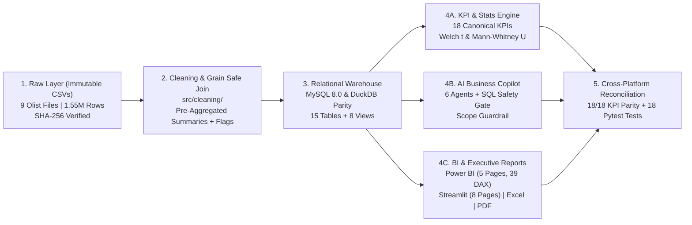
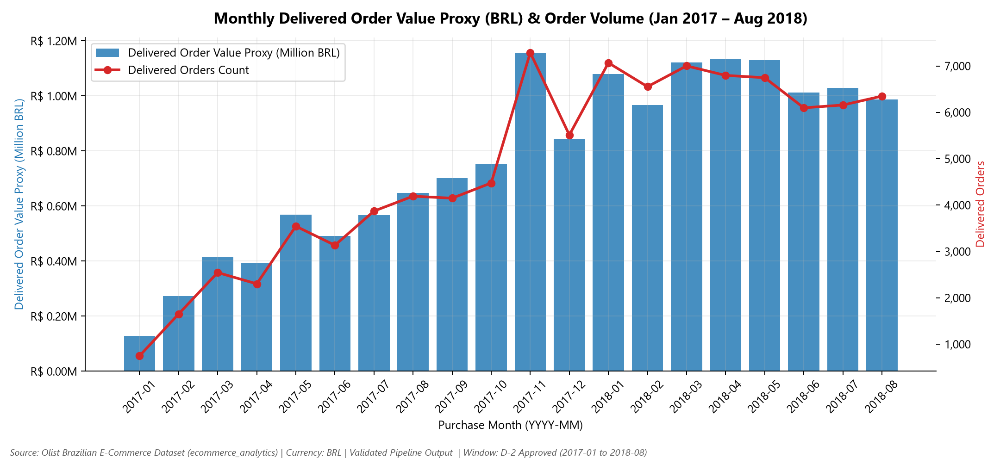
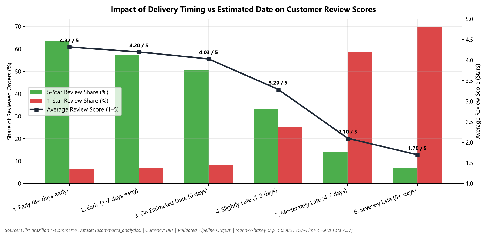
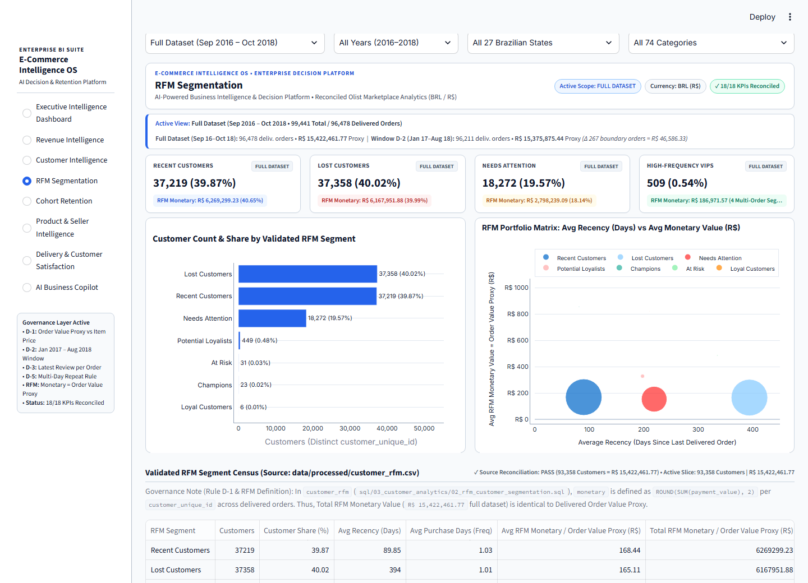

# CommerceLens AI

### AI-Powered E-Commerce Intelligence Platform
> **Turning E-Commerce Data into Intelligent Business Decisions.**  
> *Flagship End-to-End Business Intelligence, SQL, Python, Power BI, Streamlit & Agentic AI Portfolio Platform*

[](requirements.txt)
[](sql/)
[](powerbi/)
[](tests/test_analytics_pipeline.py)
[](src/analytics/reconciliation_engine.py)

---

## Product Overview

**CommerceLens AI** transforms **1,550,922 raw records across 9 relational tables** from the public **Olist Brazilian E-Commerce Dataset** (`99,441` orders from Sept 2016 to Oct 2018) into an audited, decision-ready analytics platform spanning:

- **Revenue Intelligence** (`R$ 15.42M` Delivered Order Value Proxy vs. `R$ 13.22M` Item Revenue & `R$ 2.20M` Freight)
- **Customer Intelligence & Retention** (`93,358` unique delivered customers, RFM segmentation, `2.16%` multi-day D-5 repeat rate vs. `786` same-day split checkouts, 20-month cohort retention matrix)
- **Product, Seller & Logistics SLA Analytics** (`74` translated categories, Top 10% seller Pareto concentration = `67.11%`, `-1.72★` late-delivery satisfaction cliff tested at $p < 0.0001$)
- **Grounded AI Business Copilot** (`6` coordinated agents executing read-only SQL queries against allow-listed tables with zero-hallucination scope guardrails)

| Streamlit Executive Intelligence View | Streamlit AI Business Copilot View |
|---|---|
|  |  |

---

## Table of Contents

1. [Business Problem & Objectives](#1-business-problem--objectives)
2. [Key Capabilities & Technology Stack](#2-key-capabilities--technology-stack)
3. [System Architecture & End-to-End Data Workflow](#3-system-architecture--end-to-end-data-workflow)
4. [Dataset Source, Cleaning Methodology & Data Governance](#4-dataset-source-cleaning-methodology--data-governance)
5. [KPI Definitions & Verified Scorecard](#5-kpi-definitions--verified-scorecard)
6. [Key Empirical Findings & Business Recommendations](#6-key-empirical-findings--business-recommendations)
7. [Five-Page Power BI Desktop Model & Report](#7-five-page-power-bi-desktop-model--report)
8. [Eight-Page Streamlit Application & Dashboard Gallery](#8-eight-page-streamlit-application--dashboard-gallery)
9. [AI Multi-Agent Business Copilot & Safety Architecture](#9-ai-multi-agent-business-copilot--safety-architecture)
10. [MySQL Integration, Excel Workbook & PDF Reporting](#10-mysql-integration-excel-workbook--pdf-reporting)
11. [Installation, Launch Commands & Verification Results](#11-installation-launch-commands--verification-results)
12. [Limitations, Attribution & Future Scope](#12-limitations-attribution--future-scope)

---

## 1. Business Problem & Objectives

Marketplace operators face four recurring executive blind spots on raw transactional schemas:
1. **Metric Inflation & Join Fan-Out:** Joining `orders` with `order_items`, `order_payments`, and `order_reviews` directly inflates revenue whenever an order contains multiple items or split payments.
2. **Gross Spend vs. Commission Confusion:** Mixing total buyer checkout `payment_value` with net marketplace commission or seller merchandise `price` leads to incorrect financial reporting.
3. **False Repeat-Buyer Signals:** Using checkout-level `customer_id` yields `0%` repeat purchasing, whereas naive `customer_unique_id` counts fold same-day split checkouts (`786` buyers) into multi-day retention.
4. **Disconnected Delivery & Satisfaction Reporting:** Leadership needs quantified proof of how carrier transit delays impact customer review scores across regions and seller tiers.

**Objectives:** Build a single-source-of-truth KPI layer (`src/analytics/metric_catalogue.py`), enforce strict grain separation before BI consumption, reconcile every figure across SQL, Python, Excel, PDF, Power BI, and Streamlit, and expose evidence-backed self-service Q&A through a read-only SQL agent pipeline.

---

## 2. Key Capabilities & Technology Stack

| Layer | Technologies Used | Key Engineering Outputs |
|---|---|---|
| **Data Engineering & Cleaning** | `Python 3.14`, `pandas`, `numpy` | Non-destructive quality flags, pre-aggregated order summaries, `14` processed tables + `customer_rfm` |
| **Relational Warehouse** | `MySQL 8.0`, `PyMySQL`, `SQLAlchemy`, `DuckDB` | `15` warehouse tables + `8` analytical SQL views (`sql/01..05`) + automatic DuckDB parity fallback |
| **Statistical & KPI Engine** | `SciPy`, `scikit-learn`, `Jupyter` | `18` canonical KPIs, Welch's $t$-test & Mann-Whitney $U$ SLA proof, `8` publication Matplotlib/Seaborn PNGs |
| **BI Dashboards** | `Power BI Desktop (TMDL/DAX)`, `Streamlit`, `Plotly` | `19`-table Power BI `.pbip` (`10` relationships, `39` weighted DAX measures, `5` pages) + `8`-page Streamlit app |
| **AI Decision Copilot** | Custom Multi-Agent Orchestrator | `6` specialized agents, deterministic SQL routing + Read-Only SQL Safety Validator + Scope Guardrail |
| **Executive Delivery & QA** | `OpenPyXL`, `Matplotlib PdfPages`, `Pytest` | `10`-sheet formula-driven Excel workbook, `3`-page PDF report, `18/18` automated tests |

---

## 3. System Architecture & End-to-End Data Workflow



```
data/raw/*.csv (9 Immutable Files)
   └─▶ src/cleaning/build_clean_datasets.py
         ├─▶ order_item_summary (1:1 order_id) ─┐
         ├─▶ order_payment_summary (1:1) ───────┼─▶ order_level (99,441 rows, 0 fan-out)
         └─▶ order_review_summary (1:1, D-3) ───┘      ├─▶ MySQL 8.0 (`ecommerce_analytics`) & DuckDB
                                                       ├─▶ Power BI (`Ecommerce_Intelligence_OS.pbip`)
                                                       ├─▶ Streamlit (`app/streamlit_app.py`)
                                                       ├─▶ Excel (10 Sheets) & PDF (3 Pages)
                                                       └─▶ AI Copilot (`agents/orchestrator.py`)
```

---

## 4. Dataset Source, Cleaning Methodology & Data Governance

- **Source:** [Olist Brazilian E-Commerce Public Dataset (Kaggle)](https://www.kaggle.com/datasets/olistbr/brazilian-ecommerce) (`9` raw CSV files, `99,441` orders from Sept 2016 to Oct 2018).
- **Non-Destructive Cleaning (`src/cleaning/`):**
  - Raw files in `data/raw/` are hash-verified and never modified.
  - Child tables (`order_items` `112,650` rows, `order_payments` `103,886` rows, `order_reviews` `99,224` rows) are aggregated to exact `1:1` `order_id` grain *before* joining into `order_level` (`99,441` rows).
  - Geolocation coordinates are filtered to Brazilian bounding boxes and aggregated cleanly into `geolocation_zip_lookup` (`17,737` unique zip prefixes).
  - `610` products lacking Portuguese category names are preserved as `Unknown` via quality flags (`missing_category`), and `2` missing official English category mappings (`pc_gamer`, `portable_kitchen_and_food_preparers`) are documented in `data/external/category_translation_supplement.csv`.

**Approved Governance Rules (`D-1` to `D-6`):**
1. **D-1 (Financial Separation):** `SUM(payment_value)` (`R$ 15,422,461.77`) = **Delivered Order Value Proxy** (buyer spend including freight & installment interest — **not** Olist's undisclosed commission revenue). Product/category/seller rankings strictly use **Merchandise Revenue** (`SUM(price)` = `R$ 13,221,498.11` delivered; `R$ 13,591,643.70` all orders), with **Freight Value** (`R$ 2,198,275.64` delivered) tracked separately. Cost/profitability cannot be computed because seller COGS and marketing CAC are absent.
2. **D-2 (Analysis Window):** Monthly trends and acquisition cohorts use the complete 20-month window **January 2017 – August 2018** (`99,092` total / `96,211` delivered orders), disclosing excluded sparse boundary months (`Sept–Dec 2016`, `Sept–Oct 2018`).
3. **D-3 (Review Deduplication):** Duplicate review rows (`98,410` unique `review_id`s across `99,224` rows) collapse deterministically to the most recent review per order (`98,673` reviewed orders).
4. **D-4 (Category Translations):** Retains original Portuguese category names alongside `71` official + `2` manual English mappings + `Unknown`.
5. **D-5 (True Repeat Customers):** Resolves identity via `customer_unique_id` (`93,358` delivered customers) and requires **$\ge 2$ delivered orders placed on $\ge 2$ distinct purchase dates** (`2,015` = **`2.16%`**), explicitly separating **`786` same-day split-checkout buyers (`0.84%`)** and Option-A total (`2,801` = `3.00%`).
6. **D-6 (Inactivity vs. Churn):** Recency bands (`90/180/270/365` days) measure non-contractual inactivity, not confirmed subscription churn.

---

## 5. KPI Definitions & Verified Scorecard

All monetary metrics are denominated in **Brazilian Real (`BRL` / `R$`)**:

| KPI ID | Metric Definition | Full Dataset (Sep 2016–Oct 2018) | Window D-2 (Jan 2017–Aug 2018) | Governance Rule |
|---|---|---:|---:|---|
| `KPI-001` | Total Orders (All Statuses) | `99,441` | `99,092` | `orders_clean` |
| `KPI-002` | Delivered Orders | `96,478` (`97.02%`) | `96,211` | `is_delivered = 1` |
| `KPI-004` | Delivered Order Value Proxy (`SUM(payment_value)`) | **`R$ 15,422,461.77`** | **`R$ 15,375,875.44`** | Rule D-1 |
| `KPI-005` | Delivered Merchandise Revenue (`SUM(price)`) | **`R$ 13,221,498.11`** | **`R$ 13,181,027.13`** | Rule D-1 |
| `KPI-006` | Delivered Freight Value (`SUM(freight_value)`) | **`R$ 2,198,275.64`** | `R$ 2,192,092.88` | Rule D-1 |
| `KPI-008/9` | Mean / Median Order Value Proxy | `R$ 159.86` / `R$ 105.28` | `R$ 159.81` / `R$ 105.28` | IQR `R$ 114.45` |
| `KPI-010` | Unique Delivered Customers (`customer_unique_id`) | `93,358` | `93,104` | `customer_unique_id` |
| `KPI-011` | **True Repeat Customers (D-5 Distinct Dates)** | **`2,015` (`2.16%`)** | **`2,005` (`2.15%`)** | Rule D-5 |
| `—` | Same-Day Split-Basket Buyers / Option A Total | `786` (`0.84%`) / `2,801` (`3.00%`) | `—` | Rule D-5 Sensitivity |
| `KPI-012` | Repeat Customer Revenue Share (D-5) | `4.19%` (`R$ 646,454.25`) | `—` | Avg CLV `R$ 320.82` vs `R$ 160.76` |
| `KPI-013/14` | Avg Delivery Days / Late Rate (Timestamp) | `12.56 days` / **`8.11%`** | `8.12%` late | Promised deadline SLA |
| `KPI-015/16` | Avg Review Score / Late Review Penalty | `4.16 ★` (`4.29 ★` on-time vs `2.57 ★` late) | `—` | `-1.72 ★` drop ($p < 0.0001$) |
| `KPI-017` | #1 Merchandise Category (`health_beauty`) | **`R$ 1,233,131.72`** | `—` | `8,647` delivered orders |
| `KPI-018` | Top 10% Active Sellers Merchandise Share | **`67.11%`** (`R$ 8,873,076.37`) | `—` | `297` of `2,970` sellers |

---

## 6. Key Empirical Findings & Business Recommendations

| Monthly Revenue & Orders (`2017-01` – `2018-08`) | Delivery Delay Satisfaction Cliff |
|---|---|
|  |  |

| Monthly Cohort Retention Heatmap (`M+1` – `M+12`) | Seller Pareto Concentration (`2,970` Sellers) |
|---|---|
|  |  |

1. **Structural One-Time Buying & 2.0x Repeat CLV:** True multi-day repeat purchasing is **`2.16%` (`2,015` customers)**, with M+1 cohort retention ranging from `0.184%` to `0.716%`. Targeting the **`37,219 Recent Customers`** (`R$ 6.27M` pool) with 30–60 day replenishment incentives can lift retention toward `4.00%` (`~R$ 275,000+` estimated incremental order value).
2. **Late Delivery Drives 1-Star Surge:** Crossing the estimated delivery date (`8.11%` of orders) causes reviews to drop by **`-1.72 ★`** (`4.29 ★` $\rightarrow$ `2.57 ★`, Mann-Whitney $U$ & Welch's $t = 96.49, p < 0.0001$). Severe delays (`8+` days late) generate **`69.87%` 1-star reviews**, concentrated in `RJ` (`13.47%` late) and Northeast states (`AL 23.93%`, `MA 19.67%`).
3. **Top-Decile Seller Concentration:** `297` merchants (**`10%`**) drive **`67.11%` (`R$ 8.87M`)** of item sales, and `594` (**`20%`**) drive **`82.29%` (`R$ 10.88M`)**, motivating tiered seller SLA governance and regional 3PL fulfillment hubs.

---

## 7. Five-Page Power BI Desktop Model & Report

Located under `powerbi/`, the project entrypoint is **[powerbi/Ecommerce_Intelligence_OS.pbip](powerbi/Ecommerce_Intelligence_OS.pbip)** (generated reproducibly via [powerbi/scripts/build_powerbi_project.ps1](powerbi/scripts/build_powerbi_project.ps1)):

- **Semantic Model (`19` Tables, `10` Single-Direction Relationships, `39` Weighted DAX Measures):**
  - `dim_date` (`1,096` days, marked as Date Table) + `7` granular tables (`order_level`, `order_items_clean`, `payments_clean`, `products_clean`, `sellers_clean`, `customers_clean`, `customer_rfm`) + `11` analytical summary marts (`powerbi/data_exports/`).
  - Enforces strict single-direction star-schema filtering (`order_level[PurchaseDate]` used in D-5 distinct-day DAX so `Repeat Customers (D-5 Distinct Days)` = **`2,015` / `2.16%`** and `Same-Day Multi-Order Customers` = **`786` / `0.84%`**).
  - Weighted DAX measures for CLV, RFM, category, seller, state delivery, and `Cohort Retention Rate %` (`100.00%` M0, `0.28%` M1).
- **Synced Enterprise Light Pages (`Enterprise_Light_OS_Theme.json`):**
  1. **Executive Overview** (`Year`, `Window D-2`, `Customer State`, `Product Category` synced slicers)
  2. **Revenue Intelligence** (`Year`, `Window D-2`, `Customer State`, `Product Category`, `Payment Method` synced slicers)
  3. **Customer Intelligence** (RFM & D-5 vs. Same-Day vs. Single-Order CLV breakdown)
  4. **Product and Seller Performance** (Category/Seller item revenue, delivery bucket cliff & state SLAs)
  5. **Retention Analysis** (Weighted cohort retention matrix & cohort size trends)
- *Note:* `.pbix` binaries are gitignored (`powerbi/*.pbix`); refresh and save `powerbi/Ecommerce_Intelligence_OS.pbix` interactively inside Power BI Desktop using [powerbi_dashboard_guide.md](powerbi/documentation/powerbi_dashboard_guide.md).

---

## 8. Eight-Page Streamlit Application & Dashboard Gallery

Built in [app/streamlit_app.py](app/streamlit_app.py) with global synced filters (`Scope`, `Year`, `State/Region`, `Product Category`) and Plotly visualizations:

1. **Executive Intelligence Dashboard** — Scope comparison strip (`Full Dataset` vs `Jan 2017–Aug 2018`), KPI row, monthly dual-axis trend, RFM, and category bars.
2. **Revenue Intelligence** — Checkout value decomposition (`price + freight + installments`), MoM growth, payment method & installment tiers.
3. **Customer Intelligence** — D-5 (`2.16%`) vs. Same-Day (`0.84%`) vs. Option A (`3.00%`), CLV multiplier, and D-6 inactivity bands.
4. **RFM Segmentation** — All 7 segments across `93,358` customers and CRM action matrix.
5. **Cohort Retention** — `20 × 12` cohort heatmap and M+1 trajectory.
6. **Product & Seller Intelligence** — `74` categories Pareto & seller decile concentration.
7. **Delivery & Customer Satisfaction** — Statistical SLA scorecard and state delay map/scatter.
8. **AI Business Copilot** — Benchmark questions, Read-Only SQL Sandbox, grounded summary cards, SQL lineage inspector, and audit trail.

| Revenue Intelligence | RFM Segmentation | Cohort Retention | Delivery & Satisfaction |
|---|---|---|---|
|  |  |  |  |

---

## 9. AI Multi-Agent Business Copilot & Safety Architecture

Located in `agents/`, **`AnalyticsOrchestrator`** coordinates `6` specialized agents (`DataProfilerAgent`, `DataQualityAgent`, `SQLAnalystAgent`, `CustomerAnalyticsAgent`, `BusinessInsightAgent`, `ReportAgent`):

- **Deterministic Execution vs. External LLM Mode:** In offline/default mode, natural-language intent matching and insight synthesis execute **100% deterministically** against live SQL outputs (`MySQL` when reachable or automatic `DuckDB` parity) with zero synthetic API guessing.
- **SQL Safety Gate ([agents/tools/sql_safety_validator.py](agents/tools/sql_safety_validator.py)):** Enforces single-statement `SELECT`/`WITH` execution against `23` allow-listed tables/views, blocks `DROP`, `DELETE`, `UPDATE`, `ALTER`, and `;`, and applies `LIMIT 100` row bounds.
- **Scope Guardrail:** Out-of-scope prompts (e.g., *"What is our net profit margin after marketing CAC?"*) are safely declined with transparent dataset-boundary disclosures.

---

## 10. MySQL Integration, Excel Workbook & PDF Reporting

- **MySQL 8.0 & Live Verifier ([src/database/verify_live_mysql.py](src/database/verify_live_mysql.py)):** Checks service `MySQL80`, connects via `getpass` hidden prompt (no credentials stored), verifies all `15` warehouse tables (`14` cleaned + `customer_rfm` including `geolocation_zip_lookup = 17,737`), reconciles **`22/22` live SQL KPI queries** (`0.0` abs diff), and writes `docs/mysql_live_verification_report.md` + `reports/reconciliation/mysql_live_verification.json`.
- **10-Sheet Executive Excel Workbook (`reports/executive_summary/Ecommerce_Revenue_Retention_Intelligence_Report.xlsx`):** Generated via [excel_report_builder.py](src/reporting/excel_report_builder.py) with `44` dynamic Excel formula cells (`=SUM`, `=AVERAGE`), `R$` / `%` number formatting, conditional formatting, and charts.
- **3-Page Executive PDF Report (`reports/executive_summary/Ecommerce_Intelligence_OS_Executive_Report.pdf`):** Generated via [pdf_report_builder.py](src/reporting/pdf_report_builder.py) covering canonical KPIs, charts, strategic recommendations, and analytical limitations.

---

## 11. Installation, Launch Commands & Verification Results

```bash
# 1. Install all Python dependencies
pip install -r requirements.txt

# 2. Place raw Olist CSVs into data/raw/ (from Kaggle Olist dataset) and run cleaning + analytics
python src/cleaning/build_clean_datasets.py
python src/database/execute_and_validate_sql.py
python src/analytics/kpi_engine.py
python src/analytics/reconciliation_engine.py

# 3. Launch CommerceLens AI Streamlit Dashboard
streamlit run app/streamlit_app.py

# 4. Run AI Business Copilot CLI Demo
python agents/orchestrator.py --demo

# 5. Run Full Automated Test Suite
pytest tests/ -v

# 6. Verify Live Local MySQL 8.0 Database (uses secure hidden password prompt)
python src/database/verify_live_mysql.py
```

**Verified Results:**
- **`pytest tests/ -v`:** **`18/18` passed (`0` failures, `0` skipped)** (`23.25s`).
- **`src/analytics/reconciliation_engine.py`:** **`18/18` cross-platform KPIs reconciled (`100% PASS`)**.
- **Power BI SDK (`build_powerbi_project.ps1`):** `19` tables, `10` relationships, `39` DAX measures round-trip verified; `PBIProjectShredder` `0` validation errors.
- **Live MySQL 8.0 (`22/22` KPIs PASS):** Live SQL queries reconciled `0.0` diff on `MySQL 8.0.46`; `geolocation_zip_lookup` expectation fixed (`19,015` stale raw count $\rightarrow$ `17,737` cleaned count) pending one final user re-run for `15/15` table pass badge.

---

## 12. Limitations, Attribution & Future Scope

- **Dataset Attribution & Licence:** Data sourced from the [Olist Brazilian E-Commerce Public Dataset](https://www.kaggle.com/datasets/olistbr/brazilian-ecommerce) under **CC BY-NC-SA 4.0**. Raw CSVs remain excluded via `.gitignore`. Repository source code and documentation are provided for portfolio demonstration purposes.
- **Analytical Limitations:** Covers historical Sept 2016–Oct 2018 transactions (pre-PIX), lacks seller COGS/commission/CAC data (so `payment_value` is a proxy, not corporate profit/commission), exhibits right-censoring on late-2018 repeat rates, and treats long recency as non-contractual inactivity rather than confirmed churn. This repository is a **single-tenant portfolio analytics demonstration**, not a hosted production SaaS platform.
- **Future Scope (Not Yet Implemented):** Live streaming order ingestion, probabilistic BG/NBD + Gamma-Gamma predictive CLV forecasting, automated CI/CD Power BI Service publishing, and optional external LLM API tool-calling connector.

For live walkthrough notes, see [docs/recruiter_demo_guide.md](docs/recruiter_demo_guide.md), [docs/FINAL_PROJECT_AUDIT.md](docs/FINAL_PROJECT_AUDIT.md), and [docs/architecture.md](docs/architecture.md).
