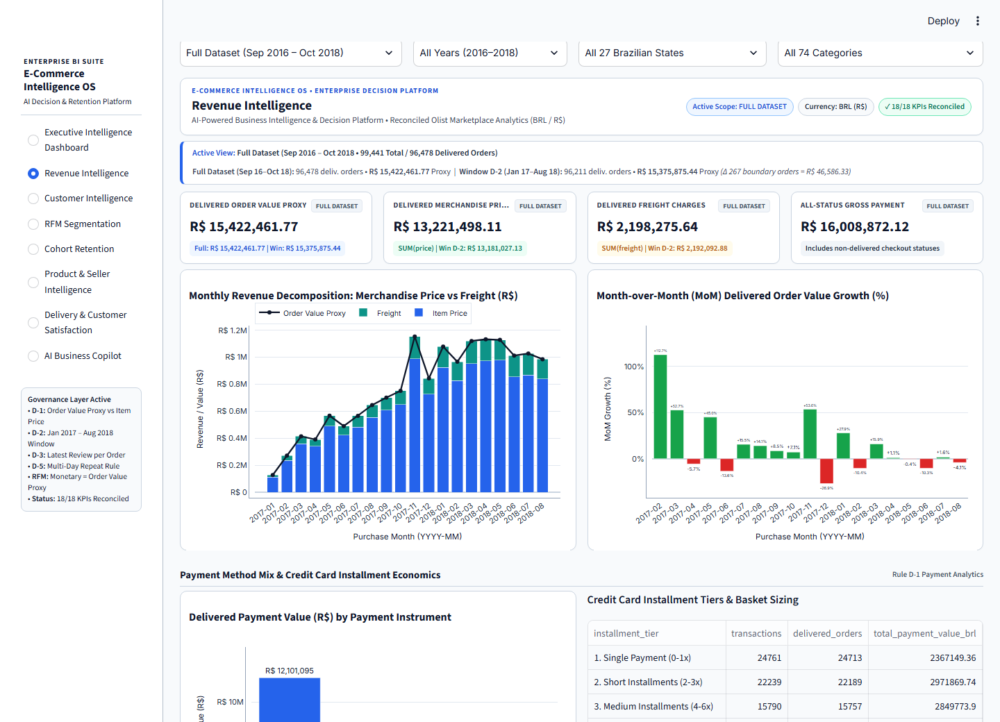
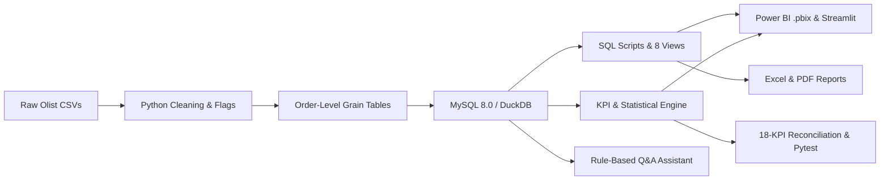

# CommerceLens AI

## E-Commerce Revenue & Retention Intelligence Platform

*Turning E-Commerce Data into Intelligent Business Decisions.*

CommerceLens AI analyses 99,441 Brazilian e-commerce orders to uncover revenue concentration, customer retention patterns and delivery-performance opportunities through Python, SQL and interactive BI dashboards.

[](https://www.python.org/)
[](sql/)
[-F2C811?logo=powerbi&logoColor=black)](powerbi/Ecommerce_Intelligence_OS.pbix)
[](app/streamlit_app.py)
[](LICENSE)

**Project Deliverables:** [Power BI Report (.pbix)](powerbi/Ecommerce_Intelligence_OS.pbix) | [Executive PDF Report](reports/executive_summary/Ecommerce_Intelligence_OS_Executive_Report.pdf) | [Architecture Documentation](docs/architecture.md)


---

## Key Business Findings & Recommendations

Across **99,441** marketplace orders (**96,478** delivered orders across **93,358** unique delivered customers, totaling **R$15,422,461.77** in delivered order value proxy), three structural dynamics drive marketplace growth, customer retention, and customer satisfaction:

| Finding | Result | Business meaning |
|---|---|---|
| **Seller concentration** | Top 10% of sellers (297 of 2,970 active sellers) generate **67.11%** of delivered item revenue (**R$8,873,076.37** of **R$13,221,498.11**) | Marketplace supply relies heavily on a small core of top merchants, creating operational dependency if key sellers churn or underperform on fulfillment. |
| **True repeat purchasing** | **2.16%** true repeat rate under Rule D-5 (**2,015** of **93,358** customers with 2+ delivered orders on 2+ distinct dates) | Customer growth relies almost entirely on new-buyer acquisition rather than habitual repeat purchasing; same-day multi-order splits (**786** buyers) represent single shopping trips, not retention. |
| **Historical customer spend comparison** | Repeat buyers average **R$320.82** historical spend proxy vs. **R$160.76** for single-order buyers | Converting even a modest share of one-time customers into multi-date buyers doubles cumulative spend per acquired customer without additional initial acquisition cost. |
| **Delivery performance and review scores** | On-time orders average **4.29 stars** vs. **2.57 stars** for late orders (-1.72 to -1.73 drop, Mann-Whitney *U* & Welch's *t* **p < 0.0001**) | Late fulfillment is the strongest operational correlate of 1-star customer reviews; protecting delivery SLAs directly protects marketplace trust scores. |
| **Payment method mix** | Credit cards contribute **78.46%** of delivered payment value (**R$12,101,094.88** across **74,586** transactions, averaging 3.5 installments) | Flexible installment financing underpins higher-ticket conversions, making payment reliability and installment UX critical for order value preservation. |
| **Cohort retention** | Month M+1 repeat retention spans **0.184%–0.716%** across the 19 observable cohorts (`2017-01` to `2018-07`) | Retention remains structurally below 1% in Month 1 across acquisition cohorts, confirming that acquisition spikes (e.g., Black Friday) do not translate into recurring cohorts automatically. |

#### Business Recommendations

1. **Customer retention:** Prioritise first-time buyers for post-purchase engagement and repeat-purchase campaigns, particularly within the **Recent Customers** segment (**37,219** buyers) before recency decays.
2. **Delivery performance:** Investigate high-delay regions and sellers—especially **AL** (**23.93%** late, 3.85 avg stars), **MA** (**19.67%** late, 3.83 avg stars), and **PI** (**15.97%** late, 3.99 avg stars), as well as high-volume market **RJ** (**13.47%** late across 12,350 delivered orders vs. **5.89%** in **SP**).
3. **Seller concentration:** Monitor dependence on high-contribution sellers and explore category diversification opportunities beyond the top Decile-1 cohort.
4. **Customer experience:** Track review scores alongside delivery performance metrics so rising delay rates trigger proactive carrier escalation before customer ratings deteriorate.

> **Metric interpretation note:** Order value proxy is not company revenue or profit; historical spend is not predictive CLV; delivery-versus-review results show association, not causation.

---

## Dashboard Gallery

### Power BI Report Pages ([`powerbi/Ecommerce_Intelligence_OS.pbix`](powerbi/Ecommerce_Intelligence_OS.pbix))

- **Executive Overview:** Top-line marketplace volume, delivered order value proxy vs. merchandise revenue, monthly trajectory, and categorical slicers (`Year`, `Analysis Window`, `Customer State`, `Product Category`).
- **Revenue Intelligence:** Category revenue leadership, payment method and installment share breakdown, and monthly growth decomposition.
- **Customer Intelligence:** D-5 repeat customer separation, same-day split-basket segmentation, RFM segments, and historical spend tiers.
- **Product and Seller Performance:** 74-category performance ranking and seller Decile Pareto concentration analysis.
- **Retention Analysis:** Cohort M+0 to M+N percentage retention matrix alongside delivery-delay SLA and review-score benchmarks.

### Streamlit Application Pages ([`app/streamlit_app.py`](app/streamlit_app.py))

| **Executive Dashboard** | **Revenue Intelligence** |
| :---: | :---: |
|  |  |
| **Customer Intelligence** | **Business Q&A Assistant** |
|  |  |

---

## Rule-Based Business Q&A Assistant

The platform includes a deterministic, rule-based Business Q&A Assistant (`agents/orchestrator.py` and `agents/sql_analyst_agent.py`) that operates completely offline with zero external API keys required:

- **Deterministic SQL templates:** Maps natural-language business questions across validated analytical intents (revenue trends, June 2018 contraction, RFM segments, D-5 repeat rate, seller concentration, cohort retention, regional SLAs, and delivery-vs-review impact) to audited SQL queries.
- **Grounded answers with SQL evidence:** Every response exposes the executed SQL statement, source tables, metric definitions, and resulting summary table.
- **Read-only SQL execution:** Enforces strict single-statement read-only validation in `agents/tools/sql_safety_validator.py`.
- **SELECT/WITH restrictions on allow-listed tables and views:** Rejects any statement not beginning with `SELECT` or `WITH`, blocks DDL/DML keywords (`DROP`, `DELETE`, `UPDATE`, `INSERT`, `ALTER`, `CREATE`, `TRUNCATE`, etc.), and restricts queries to 23 allow-listed tables and views.
- **Query row limits:** Caps returned result sets at 100 rows (`max_rows=100`) to preserve UI and CLI responsiveness.
- **Unsupported-question handling:** Explicitly declines out-of-scope prompts and lists supported marketplace domains without fabricating data.

*Optional external LLM integration for open-ended natural-language SQL generation is planned as future scope.*

---

## Architecture and Technology Stack



| Layer | Technology & Role | Key Modules |
|---|---|---|
| **Python & Pandas** | Non-destructive data cleaning, key verification, and grain-safe feature aggregation | `src/cleaning/build_clean_datasets.py` |
| **MySQL & DuckDB** | Primary MySQL 8.0 warehouse with automatic in-memory DuckDB parity fallback | `src/database/db_engine.py`, `src/database/load_data_to_mysql.py` |
| **SQL Analysis** | 14 modular analytical SQL scripts and 8 reusable reporting views | `sql/` |
| **Power BI, DAX & Power Query** | 19-table star schema, 10 single-direction relationships, 39 weighted DAX measures, 5 report pages | `powerbi/Ecommerce_Intelligence_OS.pbix`, `powerbi/dax/olist_dax_measures.dax` |
| **Streamlit & Plotly** | Interactive 8-page analytics UI with Enterprise Light Theme and global filters | `app/streamlit_app.py` |
| **Statistical Analysis** | Canonical KPI calculation plus Mann-Whitney *U*, Welch's *t*, and Spearman rank tests | `src/analytics/kpi_engine.py` |
| **Excel / PDF Reporting** | 10-worksheet formula-driven Excel workbook and 3-page Executive PDF brief | `src/reporting/excel_report_builder.py`, `src/reporting/pdf_report_builder.py` |
| **Pytest & Reconciliation** | 18 end-to-end automated pipeline tests and cross-layer 18-KPI reconciliation | `tests/test_analytics_pipeline.py`, `src/analytics/reconciliation_engine.py` |

---

## KPI Governance and Grain-Safe Joins

All downstream SQL queries, Python engines, Power BI DAX measures, Excel tables, and Streamlit pages enforce canonical rules **D-1 to D-6** (`src/analytics/metric_catalogue.py`):

| Rule | Governance Scope | Standardized Definition |
|---|---|---|
| **D-1** | **Financial metric separation** | Separates **Delivered Order Value Proxy** (`SUM(payment_value)` on delivered orders = **R$15,422,461.77**) from **Delivered Merchandise Revenue** (`SUM(price)` = **R$13,221,498.11**) and **Delivered Freight Value** (**R$2,198,275.64**). |
| **D-2** | **Analysis window** | Restricts monthly growth trends and cohort matrices to **Jan 2017 – Aug 2018** (`in_analysis_window = 1`, 20 complete months, 96,211 delivered orders) to prevent boundary distortion from sparse 2016 and right-censored late-2018 months. |
| **D-3** | **Review deduplication** | Deduplicates 99,224 review rows across 98,673 orders to one primary record per `order_id` (`order_review_summary`) ordered by `review_answer_timestamp DESC, review_creation_date DESC, review_id DESC`. |
| **D-4** | **Category translations** | Joins 71 official Portuguese-to-English mappings plus 2 documented manual mappings (`pc_gamer`, `portable_kitchen_and_food_preparers`) and labels 610 null-category products as `Unknown` (`100%` coverage across 32,951 products). |
| **D-5** | **Strict repeat-purchase definition** | Groups by `customer_unique_id` and requires 2+ delivered orders on 2+ distinct calendar dates (`2,015` / `2.16%`), separating `786` same-day multi-order split-cart buyers from true repeat customers. |
| **D-6** | **Observational inactivity & SLA interpretation** | Evaluates 90/180/270/365-day recency bands against snapshot date `2018-10-17` as inactivity rather than contractual churn, and treats late-delivery review drops as empirical association rather than causal proof. |

**Grain-Safe Join Strategy:** Because `order_items_clean` (`112,650` rows), `payments_clean` (`103,886` rows), and `reviews_clean` (`99,224` rows) have 1-to-many relationships with `orders_clean` (`99,441` rows), direct multi-table joins cause Cartesian row multiplication. CommerceLens AI pre-aggregates each child table to strict `1 row per order_id` summaries (`order_item_summary`, `order_payment_summary`, `order_review_summary`) before joining to `order_level`:
- **Order-level metrics** (`delivered orders`, `payment_value`, delivery SLAs) aggregate on `order_level` (`order_id` grain).
- **Item-level merchandise & freight metrics** aggregate on `order_items_clean` (`(order_id, order_item_id)` grain).
- **Payment transaction & installment metrics** aggregate on `payments_clean` (`(order_id, payment_sequential)` grain).
- **Customer-level KPIs, RFM & cohorts** group strictly on `customer_unique_id` (not per-order `customer_id`).

---

## Quick Start

Requires **Python 3.10+** (Windows PowerShell). MySQL is **optional**: `AnalyticsDBEngine` automatically runs against in-memory **DuckDB** over `data/processed/` when MySQL credentials are not configured.

1. **Clone the repository and create a virtual environment:**

```powershell
git clone https://github.com/ANUSHKA13102003/ecommerce-revenue-retention-intelligence.git
cd ecommerce-revenue-retention-intelligence

python -m venv .venv
```

2. **Activate the virtual environment** (run `Set-ExecutionPolicy -Scope Process Bypass` only if PowerShell blocks `Activate.ps1`):

```powershell
Set-ExecutionPolicy -Scope Process Bypass
.venv\Scripts\Activate.ps1
```

3. **Install dependencies:**

```powershell
pip install -r requirements.txt
```

4. **Download the Olist dataset into `data/raw/`:**  
Download all 9 raw CSV files from Kaggle ([Brazilian E-Commerce Public Dataset by Olist](https://www.kaggle.com/datasets/olistbr/brazilian-ecommerce)) and place them in `data/raw/`.

5. **Run the verified cleaning, SQL (DuckDB), analytics, UI, and test sequence:**

```powershell
python src/cleaning/build_clean_datasets.py
python src/database/execute_and_validate_sql.py
python src/analytics/kpi_engine.py
streamlit run app/streamlit_app.py
pytest tests/ -v
```

*(Note: `execute_and_validate_sql.py` generates `data/processed/customer_rfm.csv` and `reports/sql_outputs/*.csv` required by `kpi_engine.py` and `app/streamlit_app.py`, using DuckDB automatically if MySQL is not configured.)*

<details>
<summary><strong>Optional: MySQL setup and verification</strong></summary>

If you want to load and verify the relational warehouse in **MySQL 8.0** instead of using automatic DuckDB fallback:

1. Create `ecommerce_analytics` in MySQL using `sql/01_create_database.sql`.
2. Copy `.env.example` to `.env` (`Copy-Item .env.example .env`) and set `MYSQL_PASSWORD` (along with `MYSQL_HOST`, `MYSQL_PORT`, `MYSQL_USER`, and `MYSQL_DATABASE`).
3. Load the 14 cleaned CSVs and verify live MySQL tables and queries:

```powershell
python src/database/load_data_to_mysql.py
python src/database/verify_live_mysql.py
python src/database/execute_and_validate_sql.py
```

`load_data_to_mysql.py` prompts interactively for connection details and a hidden password; `verify_live_mysql.py` reads `MYSQL_PASSWORD` from `.env` or prompts via `getpass` and writes `docs/mysql_live_verification_report.md`.

</details>

---

## Repository Structure

```text
ecommerce-revenue-retention-intelligence/
├── .env.example
├── .gitignore
├── LICENSE
├── README.md
├── requirements.txt
├── agents/                  # Orchestrator, 6 analytical agent modules & SQL safety gate
├── app/                     # Streamlit 8-page BI application (streamlit_app.py)
├── config/                  # Settings and environment configuration loader
├── data/
│   ├── external/            # Category translation supplement CSV
│   ├── processed/           # Cleaned outputs generated locally (excluded from Git)
│   └── raw/                 # Raw Kaggle Olist CSV placement directory (excluded from Git)
├── docs/                    # Architecture, methodology, metric catalogue, screenshots & audit docs
├── notebooks/               # 6 exploratory & analytical Jupyter notebooks
├── powerbi/                 # Compiled .pbix, .pbip project files, DAX measures & CSV star-schema exports
├── reports/                 # Analytics summary JSONs, charts, Excel/PDF reports & SQL outputs
├── sql/                     # Database DDL, analysis scripts, RFM, cohort SQL & 8 analytical views
├── src/                     # Ingestion, cleaning, MySQL/DuckDB engine, KPI engine & report builders
└── tests/                   # Automated pytest pipeline validation suite
```

---

## Verification

| Verification | Recorded result |
|---|---|
| Automated tests | 18/18 passed |
| KPI reconciliation | 18/18 passed |
| MySQL table verification | 15/15 tables |
| MySQL KPI verification | 22/22 checks |

Results from the project's recorded verification runs.

---

## Limitations and Future Scope

**Limitations:**
- **Historical scope:** Dataset spans September 2016 – October 2018 (`20` complete months from Jan 2017 – Aug 2018) and predates post-2018 Brazilian payment shifts such as PIX.
- **Currency:** All financial values are reported in **Brazilian Real (`BRL` / `R$`)**.
- **Missing cost structure:** Item COGS, marketplace commission take-rate, marketing acquisition cost (CAC), and return handling costs are absent; therefore direct company profit and net margin cannot be measured.
- **Observational design:** Late delivery vs. review score differences measure statistical association, not causal intervention effects.
- **Right-censored cohorts:** Mid-2018 acquisition cohorts have short follow-up windows (`0–2` months) before dataset cutoff.

**Future Scope:**
- Incremental CDC / scheduled ingestion pipelines to replace batch CSV snapshots.
- Predictive CLV modelling (e.g., BG/NBD + Gamma-Gamma) and probabilistic repeat-purchase scoring.
- Controlled A/B testing framework to measure causal uplift from retention and SLA interventions.
- Optional external LLM integration on top of the read-only SQL allow-list gate.

---

## Dataset Attribution and Licensing

- **Dataset Source:** [Brazilian E-Commerce Public Dataset by Olist](https://www.kaggle.com/datasets/olistbr/brazilian-ecommerce) (Kaggle), provided under the **Creative Commons Attribution-NonCommercial-ShareAlike 4.0 International (`CC BY-NC-SA 4.0`)** licence.
- **Data Governance & Non-Commercial Terms:** Raw Kaggle CSVs and cleaned `data/processed/*.csv` files are excluded from Git via `.gitignore`. Embedded Olist-derived aggregates in `powerbi/Ecommerce_Intelligence_OS.pbix` and `powerbi/data_exports/` remain subject to `CC BY-NC-SA 4.0` attribution, non-commercial use, and ShareAlike requirements.
- **Software Licence:** Project Python source code, SQL scripts, DAX definitions, tests, and documentation are licensed separately under the **MIT License** ([LICENSE](LICENSE)), which does not override the dataset's `CC BY-NC-SA 4.0` terms.

---

**Author:** ANUSHKA13102003 — [GitHub Profile](https://github.com/ANUSHKA13102003)
