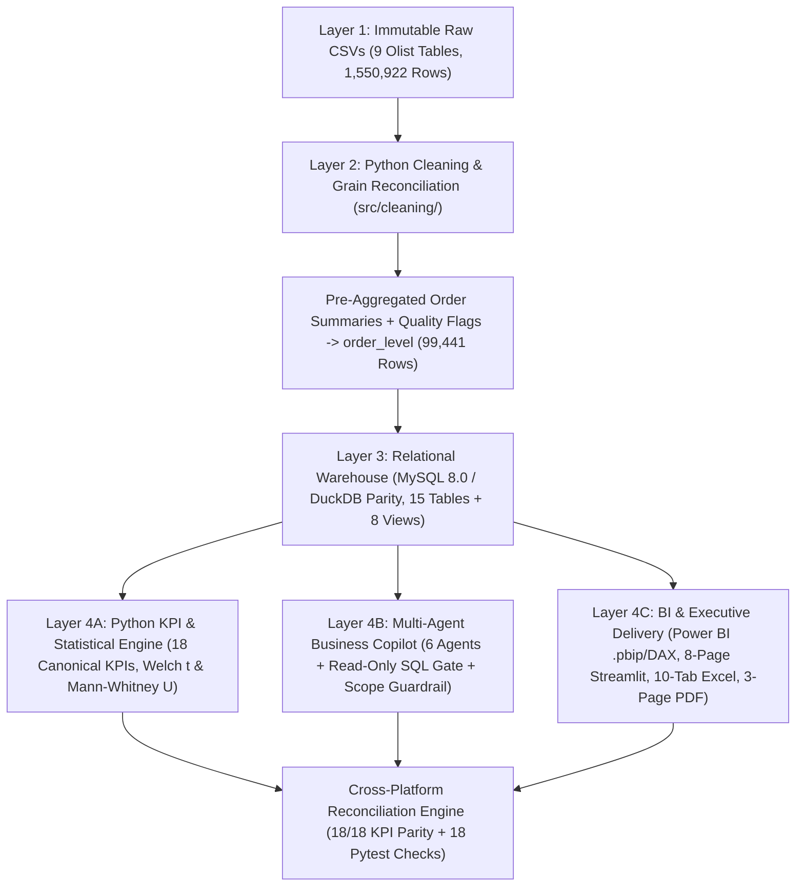

# CommerceLens AI — System & Data Architecture

**Product:** **CommerceLens AI** (*AI-Powered E-Commerce Intelligence Platform*)  
**Tagline:** *Turning E-Commerce Data into Intelligent Business Decisions.*

## 1. End-to-End Architecture & Workflow Diagrams

CommerceLens AI implements a reproducible, multi-layer analytics architecture designed for **raw data immutability**, **grain safety**, **dual-engine SQL portability**, and **grounded AI decision intelligence**:



```
┌─────────────────────────────────────────────────────────────────────────┐
│ LAYER 1: RAW DATA SOURCES (Immutable — data/raw/*.csv)                  │
│ 9 Olist Brazilian E-Commerce CSV files | 1,550,922 rows | SHA-256 hash  │
└───────────────────────────────────┬─────────────────────────────────────┘
                                    ▼
┌─────────────────────────────────────────────────────────────────────────┐
│ LAYER 2: CLEANING & GRAIN RECONCILIATION (src/cleaning/ → processed/)   │
│ • Non-destructive quality flags (zero silent row deletions)             │
│ • Pre-join aggregations (order_item_summary, order_payment_summary,     │
│   order_review_summary) to eliminate fan-out multiplication             │
│ • Unified order_level fact table (99,441 rows; 96,478 delivered)        │
└───────────────────────────────────┬─────────────────────────────────────┘
                                    ▼
┌─────────────────────────────────────────────────────────────────────────┐
│ LAYER 3: RELATIONAL WAREHOUSE & SQL ENGINE (src/database/ + sql/)       │
│ • Primary: MySQL 8.0 (utf8mb4) via SQLAlchemy/PyMySQL                   │
│ • Automatic Parity Engine: DuckDB in-memory relational engine           │
│ • 15 Base Tables (14 cleaned + customer_rfm) + 8 Analytical Views       │
└───────┬───────────────────────────┬───────────────────────────┬─────────┘
        ▼                           ▼                           ▼
┌──────────────────────┐ ┌─────────────────────────┐ ┌────────────────────┐
│ LAYER 4A: PYTHON &   │ │ LAYER 4B: AGENTIC AI    │ │ LAYER 4C: BI &     │
│ STATISTICAL ENGINE   │ │ ANALYTICS LAYER         │ │ EXECUTIVE DELIVERY │
│ • kpi_engine.py      │ │ • AnalyticsOrchestrator │ │ • 10-Tab Excel     │
│ • chart_generator.py │ │ • 6 Specialized Agents  │ │ • 3-Page Exec PDF  │
│ • 6 Jupyter Notebooks│ │ • Read-Only SQL Gate    │ │ • Power BI (.pbip: │
│ • Welch's t & Mann-  │ │ • Audit Trail Logging   │ │   19 Tables, 39 DAX│
│   Whitney U Tests    │ │   (agent_audit_log.json)│ │ • 8-Page Streamlit │
└──────────────────────┘ └─────────────────────────┘ └────────────────────┘
```

---

## 2. Core Architectural Design Decisions

### 2.1 Pre-Aggregation to Prevent Fan-Out Multiplication
In the raw Olist schema:
- `olist_order_items_dataset` has `112,650` rows across `98,666` orders (1-to-many).
- `olist_order_payments_dataset` has `103,886` rows across `99,440` orders (1-to-many).
- `olist_order_reviews_dataset` has `99,224` rows across `98,673` orders (many-to-many).

Joining these tables directly at the line-item/payment/review level causes Cartesian fan-out (`SUM(payment_value)` is inflated whenever an order has $\ge 2$ items, and `SUM(price)` is inflated whenever an order has $\ge 2$ payment installments/vouchers).

**Architectural Solution:**  
Phase 4 (`src/cleaning/clean_and_transform.py`) aggregates each child table to a strict `1 row per order_id` summary (`order_item_summary`, `order_payment_summary`, `order_review_summary`) *before* joining to `orders_clean` to form `order_level` (`99,441` rows). This guarantees exact cent-for-cent financial reconciliation (`R$ 15,422,461.77` delivered order value proxy; `R$ 13,221,498.11` delivered item revenue).

### 2.2 Dual-Backend SQL Engine (`src/database/db_engine.py`)
`AnalyticsDBEngine` automatically connects to **MySQL 8.0** when `MYSQL_PASSWORD` is configured in `.env` and MySQL is reachable. When running in environments without a live MySQL daemon (e.g., CI/CD, Streamlit Cloud, or local review), it transparently initializes an in-memory **DuckDB** relational database loaded from `data/processed/*.csv`, translates MySQL dialect functions (`DATE_FORMAT`, `DATEDIFF`, `YEAR`, `MONTH`), and auto-creates all 8 analytical views from `sql/05_views/01_analytical_views.sql`.

### 2.3 Defense-in-Depth SQL Safety Gate (`agents/tools/sql_safety_validator.py`)
Every SQL query generated or routed by `SQLAnalystAgent` — or typed into the Streamlit SQL Sandbox — must pass `validate_sql_query()` before execution:
1. Must be a single statement (semicolon-separated multi-statements are rejected).
2. Must start with `SELECT` or `WITH`.
3. Must contain zero DDL/DML/administrative tokens (`DROP`, `DELETE`, `UPDATE`, `INSERT`, `TRUNCATE`, `ALTER`, `CREATE`, `GRANT`, `COPY`, `ATTACH`, `PRAGMA`, etc.).
4. Must reference only the `23` allow-listed tables and views in `ecommerce_analytics` (while properly recognizing query-local CTEs).
